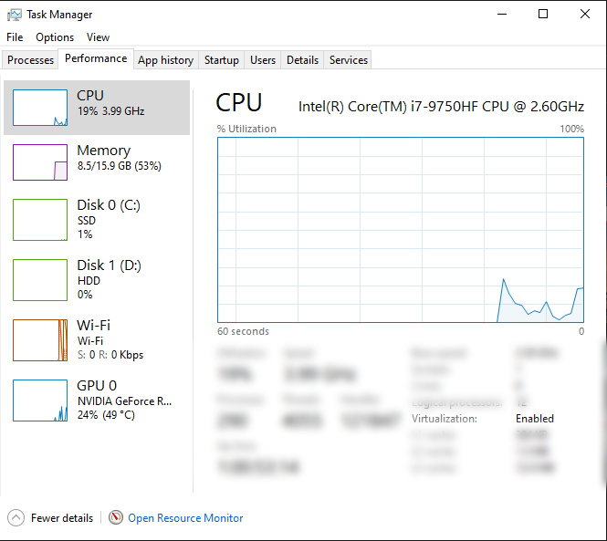

Container jobs run inside WSL, which needs hardware virtualization. Most PCs from the last decade support it, but it is
not always switched on. Here is how to check.

1. Press **Ctrl + Shift + Esc** to open Task Manager (or press **Ctrl + Alt + Del** and select **Task Manager**).
2. Open the **Performance** tab.
3. Select **CPU** in the left column.
   
4. Below the graph, look for **Virtualization**. It shows **Enabled** or **Disabled**.

- **Enabled:** you're set.
- **Disabled:** your CPU supports it but it is turned off in the BIOS/UEFI. Follow
  [How to enable virtualization support on your machine](/guides/your-pc/how-to-enable-virtualization-support-on-your-machine).
- **Not listed at all:** your CPU most likely doesn't support virtualization, and the machine can't run container jobs.
