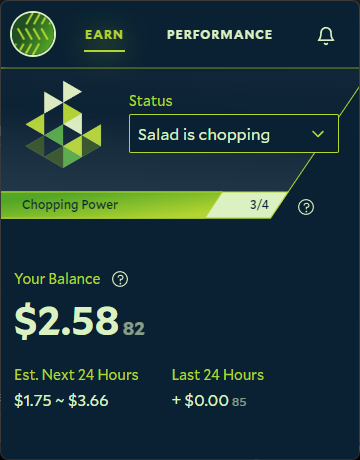

While Chopping, the Salad app shows an **Estimated Earnings** figure: how much Salad Balance you would earn in 24 hours
if your current job kept running at its current rate. It is a projection, not a promise.

## How it is calculated

The app takes what you earned over the last few minutes and multiplies it out to a full day. Because jobs start, stop
and change priority through the day, the figure goes up and down constantly. For an accurate picture of what you have
actually earned, use the [earnings history](/guides/using-salad/earnings-summary) in the Salad web app.

The figure is for the machine you are looking at only. If you have several machines on one account, each shows its own
estimate, and your actual earnings are combined across all of them.

## Why did I earn a different amount than estimated?

- **The job ended.** Jobs are often short, and the estimate assumed it would run all day. While the app shows **Finding
  Job**, nothing is earned and the estimate drops to zero.
- **A different job paid a different rate.** Each job's rate is set by the customer's chosen priority, so your next job
  can pay more or less than the last. See [Network Monitor](/faq/jobs/network-monitor).
- **No job was available.** Chopping means your machine is available for jobs. If there is no job for your hardware, or
  you have disabled the backup workloads such as mining, there is nothing to estimate from until one arrives. See
  [How does my machine earn Salad Balance?](/faq/jobs/how-does-my-machine-earn-salad-balance)
