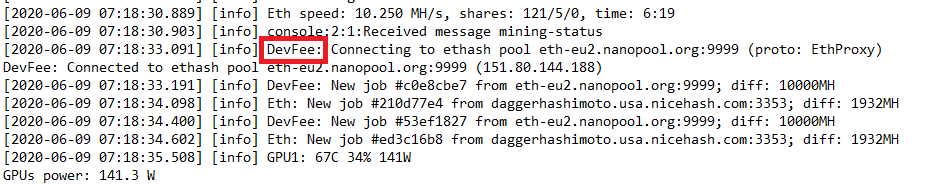

Mining on Salad is a backup, not the main event. It only runs when no container job is available for your machine, it
pays very little on modern hardware, and you can turn it off. This page answers every common question about it.

## What mining is on Salad today

Mining was Salad's original workload, back when it was a reliable way to put GPUs to work. Today container jobs for
SaladCloud customers are what your machine earns from, and mining is simply the fallback that keeps the GPU doing
something between jobs. The moment a container job is available, Salad stops mining and runs the job instead.

Salad is not a mining pool. It runs standard miners against third-party pools and credits you in Salad Balance, so you
never deal with pools, wallets or coins yourself.

## What it pays

On a modern GPU, mining earns cents per day. It will never come close to the container rates on the
[Network Monitor](/faq/jobs/network-monitor), and on many machines it earns less than the electricity it uses. Treat it
as a signal that your machine is online and waiting, not as income. If you want more Salad Balance, the lever is
container jobs; see [How do I get container jobs?](/faq/jobs/how-do-i-get-container-jobs)

## Which programs run, and why antivirus flags them

Salad uses well-known open-source miners and picks the one that suits your GPU: XMRig, Rigel, T-Rex, lolMiner, GMiner,
miniZ and TeamRedMiner. If one fails to start, Salad retries with another compatible miner, and the set changes over
time as miners are updated or retired. Mining support for some newer cards, including NVIDIA's 50-series, has been
inconsistent while the miners catch up with them.

Antivirus software very often flags these miners, because the same programs are abused by malware to mine on infected
PCs without consent. On Salad they run only when you enable mining, in the open, and stop when you stop Chopping. If
your antivirus quarantines them, mining won't run; see [Antivirus](/troubleshooting/antivirus) for how to allow Salad,
or just turn mining off.

## Dev fees

The "dev fee" lines in your logs are not a Salad fee. Every open-source miner reserves a small share of its mining time
for its own authors; that is how those projects are funded. Salad doesn't control it and doesn't receive any of it.

## How Salad picks what to mine

Salad chooses the miner, algorithm and coin automatically, going for the most profitable option your GPU can run at
stock settings. If that option fails, it falls back to the next best. You can't choose a coin or point Salad at your own
pool, and only one GPU is mined on; if you have several very different cards, only the main one is used (see
[Can I use multiple GPUs?](/faq/compatibility/can-i-use-multiple-gpus)). Salad is limited to the pools and algorithms it
is integrated with, so a coin that looks more profitable on another site may simply not be available.

## How often it pays

Mining earnings are credited roughly every 15 minutes. Some intervals can be empty, because mining is probabilistic:
your machine submits work, but rewards only arrive when a share is found. Over a day the total evens out to the expected
rate for your card.

## Why it doesn't match WhatToMine

Sites like WhatToMine or NiceHash show a best-case estimate: a GPU running perfectly, 24 hours a day, with average luck
and nothing else running. Real mining is random and rarely hits that. Salad also runs on stock clocks, uses only the
pools it supports, and accounts for the miner's dev fee, so your rate will be lower than those estimates.

## How to turn it off

If mining isn't worth it for you, which on modern hardware is usually the case, turn it off in the Salad app under
**Settings > Workload Types**. You can also reach it via **Performance > Configure Hardware > Advanced Options > Crypto
Mining**. Your machine will then wait in **Finding Job** between container jobs instead of mining.

If mining is enabled but won't run, see
[Troubleshooting mining jobs](/troubleshooting/not-earning/troubleshooting-mining-jobs).
