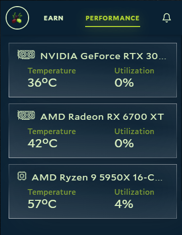

Task Manager often shows little or no GPU activity while Salad is working. By default its GPU graph tracks the 3D
engine, but container jobs use the compute engine, which Task Manager doesn't show unless you change the graph. Jobs
also run inside WSL, so the usage isn't attributed to a process named Salad.

To see what Salad is really using, open the **Performance** tab in the Salad app, which reports GPU and CPU usage for
the running job.

If you want Task Manager to show it, open its **Performance** tab, select your GPU, and change one of the graphs from
**3D** to **Compute** or **Cuda** using the drop-down above it.

Low CPU usage is normal for many jobs; see
[Why is Salad not fully using my CPU?](/faq/compatibility/why-is-salad-not-fully-using-my-cpu)
