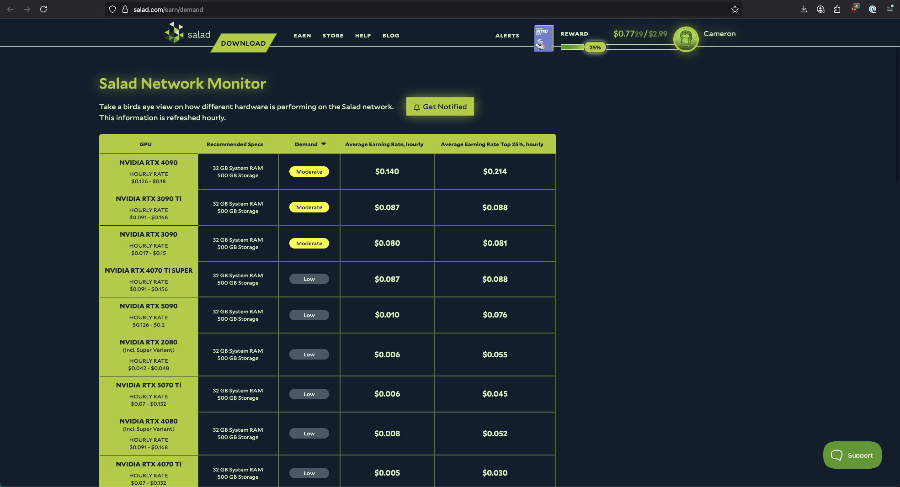
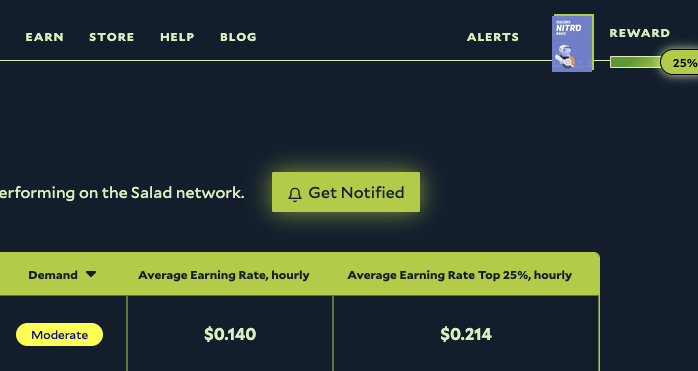
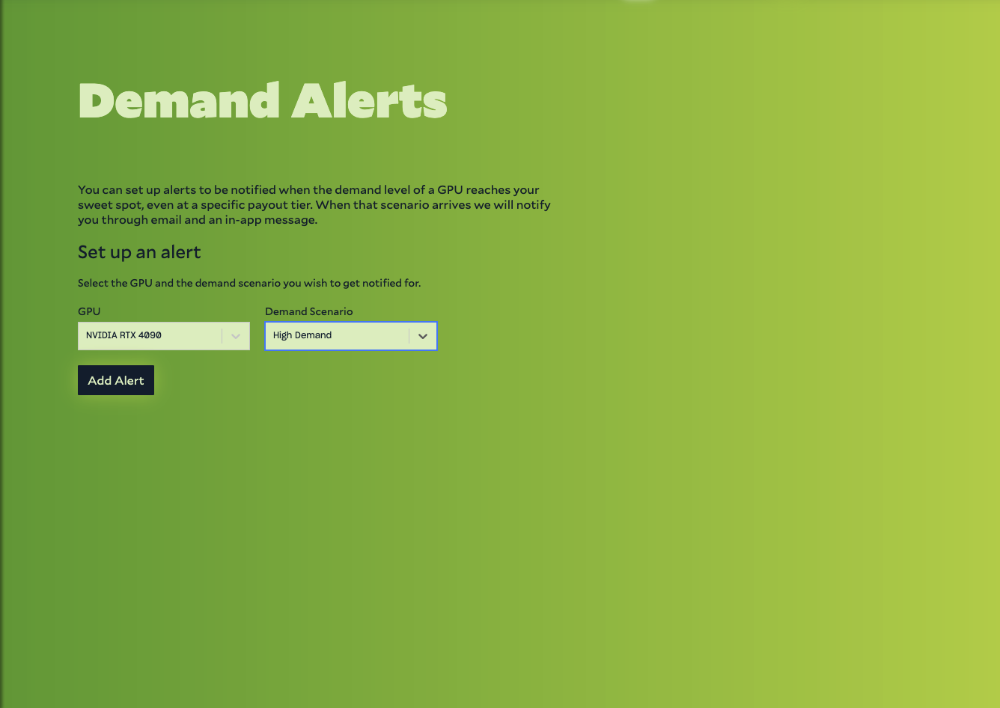

A demand alert notifies you when demand for your hardware on the [Network Monitor](/faq/jobs/network-monitor) rises or
falls to a level you choose. It is useful when demand for your GPU is low and you would rather pause Salad until it
picks up again.

1. Open the [Network Monitor](https://salad.com/earn/demand) in your web browser.
   
2. Log in with your Salad account if you haven't already.
3. At the top of the page, select **Get Notified**.
   
4. Choose the hardware type you want alerts for from the dropdown.
5. Choose the demand level that should trigger the alert: Low, Moderate or High.
   
6. Click **Add Alert**. You can add several alerts for different hardware types and demand levels.

You get an email and an in-app notification when demand for that hardware reaches the level you picked. To stop the
alerts, click **Unsubscribe** on the same page.

Not sure which hardware type to pick? See
[What GPU or CPU is Salad detecting?](/guides/your-pc/what-gpu-or-cpu-is-salad-detecting).
