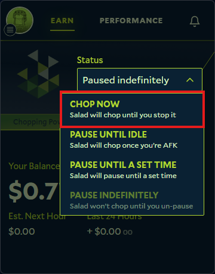

With Salad [downloaded](/guides/getting-started/downloading-salad),
[your account created](/guides/getting-started/how-to-register-and-log-into-salad) and
[setup finished](/guides/getting-started/setting-up-the-salad-app), you are ready to earn.

Open the Salad app from your system tray and select **Chop Now** from the dropdown in the center of the window. Salad
takes a few minutes to prepare your machine, then starts looking for work.

## The compatibility check comes first

The first job Salad runs on a new machine is a short compatibility check, not a paid job. It downloads a small test
workload (around 60 MB) and runs it to confirm your container environment, GPU and network all work. This check must
complete once before paid jobs are offered to your machine. If it fails or never finishes, see
[Why am I not receiving any jobs?](/troubleshooting/not-earning/why-am-i-not-receiving-any-jobs).

## What to expect on the first run

- **Finding Job** can last a while on a first run, sometimes an hour or more. This is normal: your machine is new to the
  network and jobs are assigned based on demand for your hardware. Leave Salad running.
- If your GPU is [in demand on the Network Monitor](/faq/jobs/network-monitor), or your machine qualifies for
  [Bandwidth Sharing](/faq/jobs/what-is-bandwidth-sharing), you will usually get a job sooner.
- Container jobs are large downloads, so the first one can take a while depending on your
  [internet speed](/guides/your-pc/improve-internet-speed).
- Once a job is running, your Salad Balance starts increasing within about 15 minutes. If it takes longer the job may
  still be starting up.

Leave Salad Chopping for a few hours and you should have enough Salad Balance to
[redeem your first reward](/guides/getting-started/redeeming-your-first-reward).

If "Finding Job" never ends, see [Finding Job for hours](/troubleshooting/not-earning/finding-job-for-hours).
