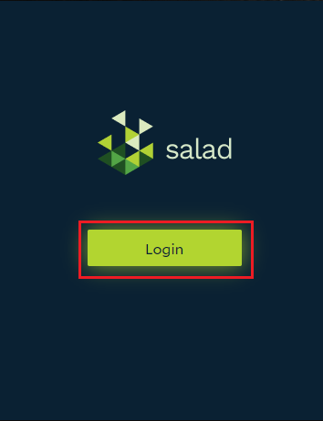
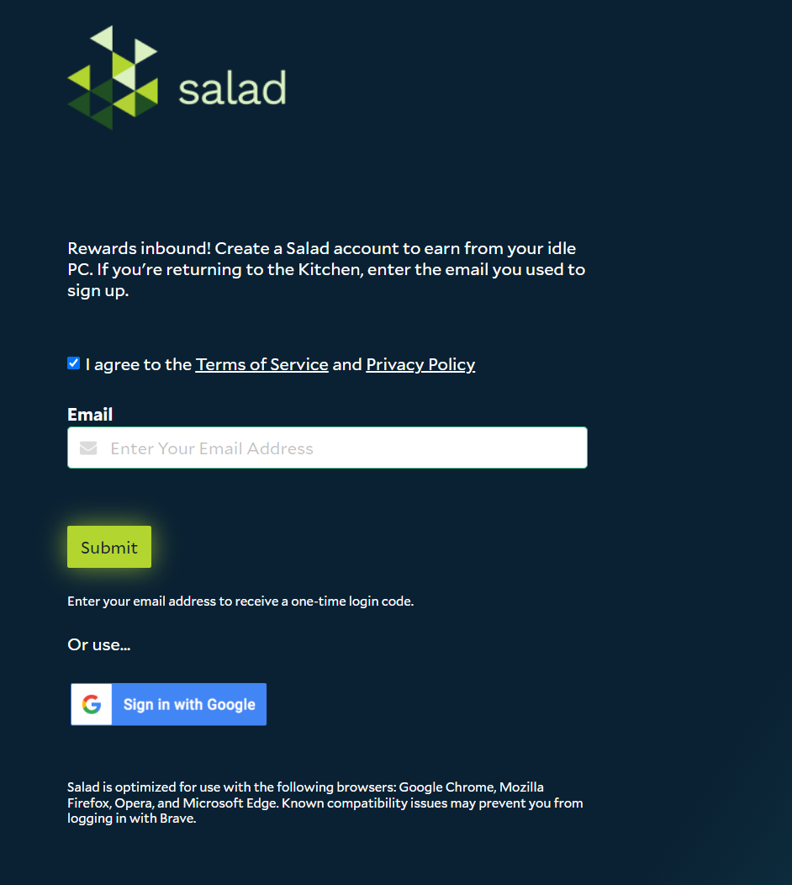

Salad has no passwords. You sign in with a one-time code sent to your email, or with your Google account. Registering
and logging in use the same steps, and the first login creates your account.

1. Open the Salad app from your system tray.

   

2. Click **Login**. A login page opens in your web browser.

   

3. Enter your email address, or choose **Sign in with Google**. Accept the Terms of Service and click **Submit**.

   

4. If you used an email address, enter the one-time passcode from the email you just received and click **Submit**.
   Check your spam folder if it does not arrive within a couple of minutes.

   

5. You are now logged into both the website and the Salad app. Return to the app to continue setup.

Use the same email address every time you log in: a new address creates a new, empty account, and
[Salad cannot change the email on an existing account](/faq/your-account/can-i-change-the-email-address-for-my-account).
Once you are set up, consider [adding a passkey](/guides/using-salad/salad-app-passkeys) to protect your account.

Having trouble logging in? See
[I am having trouble connecting to the Salad app](/troubleshooting/connection-and-login/i-am-having-trouble-connecting-to-the-salad-app)
or
[I can't enter my email address to log in](/troubleshooting/connection-and-login/i-cant-enter-my-email-address-to-log-in).

Next step: [set up the Salad app](/guides/getting-started/setting-up-the-salad-app).
