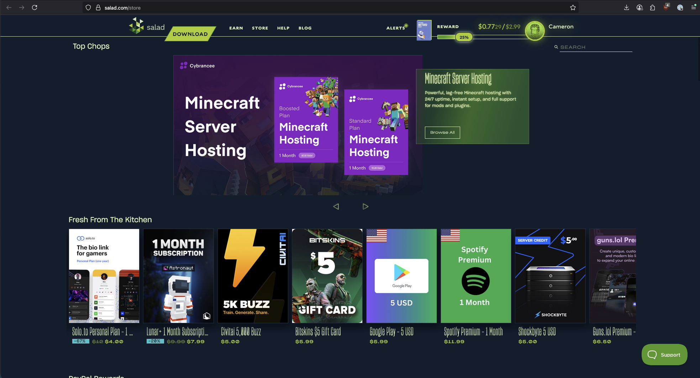
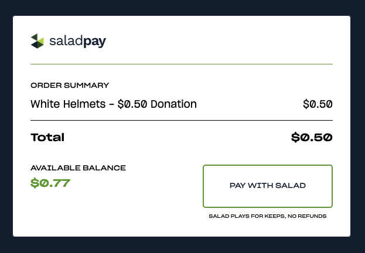

Once you have earned some Salad Balance, open the [Salad Storefront](https://salad.com/store) in your web browser. It
offers gift cards, game codes, subscriptions, PayPal and prepaid Visa/Mastercard rewards.

For a first redemption, pick something inexpensive so you don't have to wait long. A
[$1 Amazon gift card](https://salad.com/store/search?q=amazon%20gift%20card&size=n_20_n&filters%5B0%5D%5Bfield%5D=price&filters%5B0%5D%5Bvalues%5D%5B0%5D%5Bto%5D=n_5_n&filters%5B0%5D%5Bvalues%5D%5B0%5D%5Bfrom%5D=n_1_n&filters%5B0%5D%5Bvalues%5D%5B0%5D%5Bname%5D=%241%20to%20%245&filters%5B0%5D%5Btype%5D=all)
or a [donation to a charity](https://salad.com/store/search?q=Donation&size=n_20_n) are good first picks.

Click a reward to open its details. Before you buy, check the
[region the reward is for](/rewards/help/what-region-is-this-reward-for) and any other restrictions in the description:
[Salad does not offer refunds](/rewards/help/i-want-a-refund). When you are ready, click **Buy Now** at the top right
and confirm your purchase.

Your reward is delivered to your [Reward Vault](/rewards/help/reward-vault-and-redemption-codes) and to your email
address. The Reward Vault is in the Store dropdown at the top of the page.

> Some rewards, such as PayPal and prepaid Visa/Mastercard, need extra steps. Check your email for instructions.

For more detail see [How to redeem a reward](/rewards/help/how-to-redeem-a-reward). To earn faster, read the
[Getting Jobs](/guides/getting-jobs) guides.
