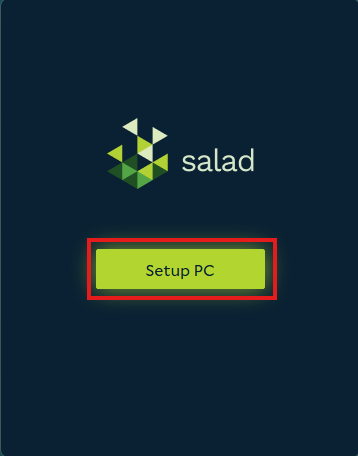
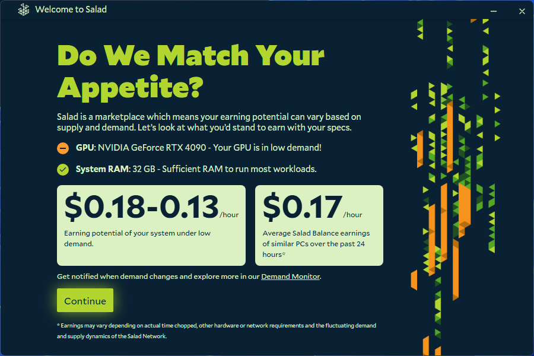
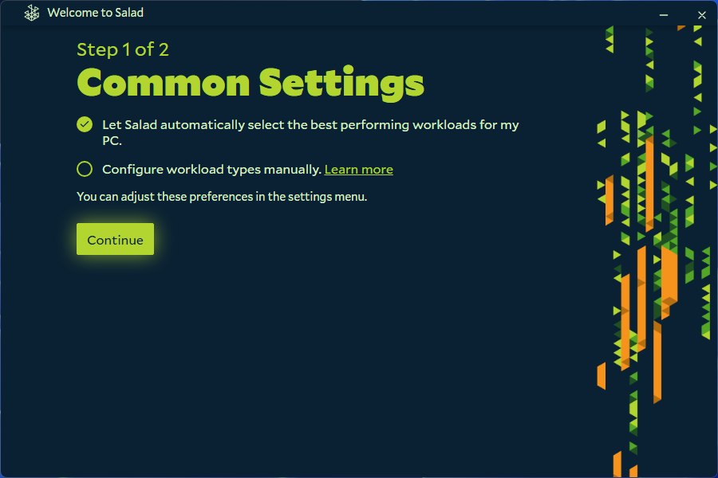

The first time you open the Salad app after logging in, a setup wizard checks your hardware and configures the app for
you. It only takes a minute.

1. Click **Setup PC**.
   
2. Review the hardware Salad detected and the estimated earning rates, then click **Continue**. If a GPU or CPU is
   missing here, see [What GPU or CPU is Salad detecting?](/guides/your-pc/what-gpu-or-cpu-is-salad-detecting).
   
3. Let Salad automatically configure the best workloads for your machine, then click **Continue**. You can change this
   later under [Workload Preferences](/guides/getting-jobs/workload-preferences).
   
4. Optionally pick a target reward from the Storefront to track your progress, or click **Skip For Now**.
   
5. Click **Finish Setup**. The app minimizes to your system tray; open it from there.
   

During setup Salad may ask to install or enable Windows features such as virtualization and the container environment
(WSL). These are required for container jobs, which pay the most. If setup reports a problem with them, see
[How to enable virtualization support on your machine](/guides/your-pc/how-to-enable-virtualization-support-on-your-machine)
and [What is WSL?](/guides/your-pc/what-is-wsl).

Next step: [get your first job](/guides/getting-started/getting-your-first-job).
