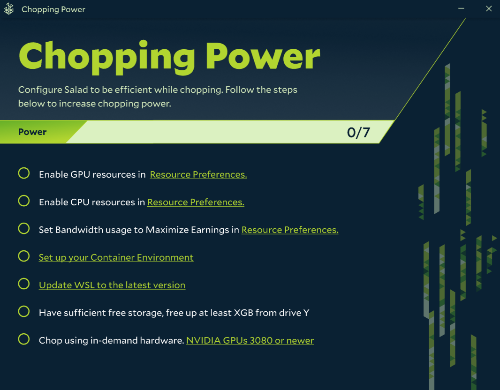
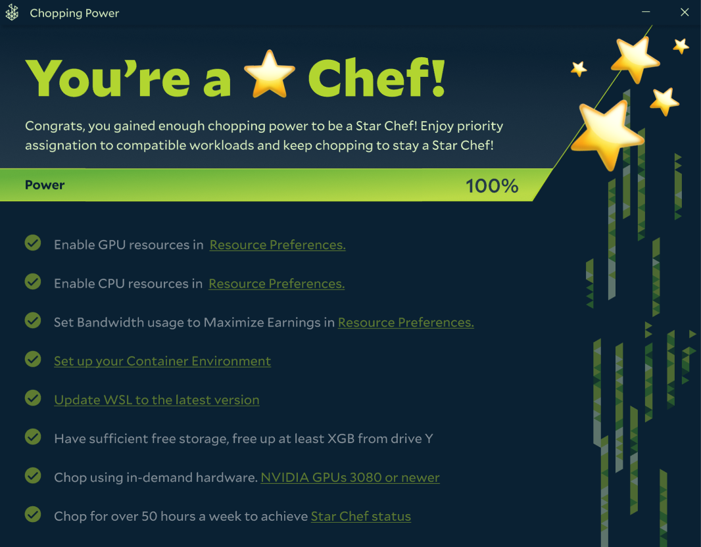

Chopping Power shows your earning efficiency on the Salad network. We determine Chopping Power based on what resources
you make available to Salad. There are some tasks for you to complete, like enabling your GPU, and some conditions that
increase your Chopping Power if they are met.

---

## How does Salad Determine your Chopping Power?

The conditions below make up your total Chopping Power. You don't have to meet all of them to earn: Chopping Power is an
indicator of how efficiently your machine earns, not a list of requirements. The options you see depend on what you
enabled during setup and on your machine's capabilities.

### Enable GPU + CPU

Enable both CPU and GPU under [Workload Preferences](/guides/using-salad/how-to-enable-and-disable-hardware). Container
jobs need both to run.

### Set Bandwidth Settings

One of the jobs available to chefs on the Salad network is [Bandwidth sharing](/faq/jobs/what-is-bandwidth-sharing).
Chefs can maximize their earnings by enabling sharing.

### Become Job-Ready

Jobs on the Salad Network require [WSL](/guides/your-pc/what-is-wsl) and
[Virtualization](/guides/your-pc/how-to-enable-virtualization-support-on-your-machine) on the Chef's machine.

### Update WSL (If Prompted)

Some chefs may need to [update WSL](/troubleshooting/degraded-state/failed-to-update-container-environment) on their
machines. If so, Salad will walk you through the update as a Chopping Power condition.

### Have Enough Free Storage

Container jobs need free space on your C: drive. Freeing up the amount Salad asks for gives your machine more
opportunities to run jobs. See [Getting container jobs](/guides/getting-jobs/getting-container-jobs).

### Have In-Demand Hardware

GPUs that are currently in demand on the [Network Monitor](/faq/jobs/network-monitor), typically recent NVIDIA cards
with plenty of VRAM, get the most jobs.

Don't worry if you don't meet every condition. The bar is a quick way to see whether your machine is optimized to earn,
but there are still jobs for Chefs without in-demand hardware or Bandwidth Sharing in their area.

