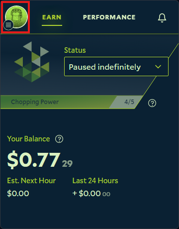
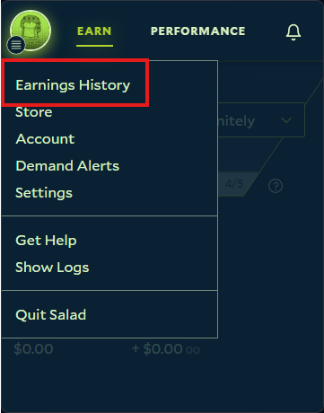
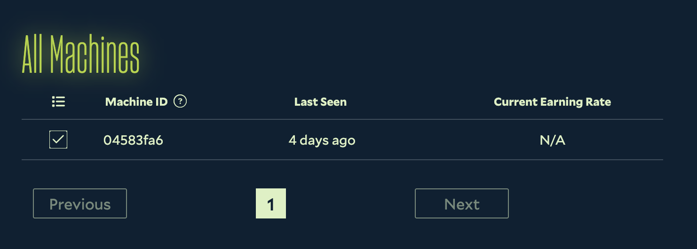
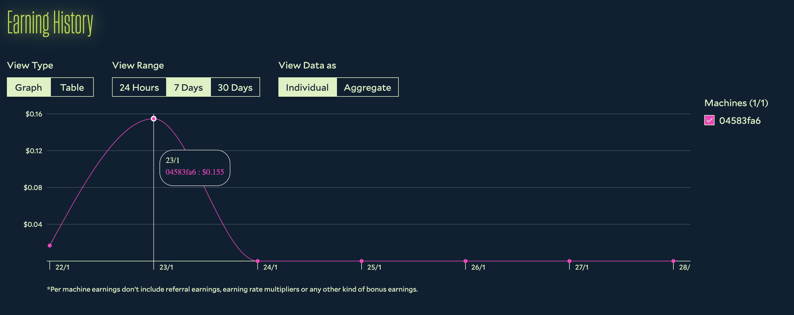
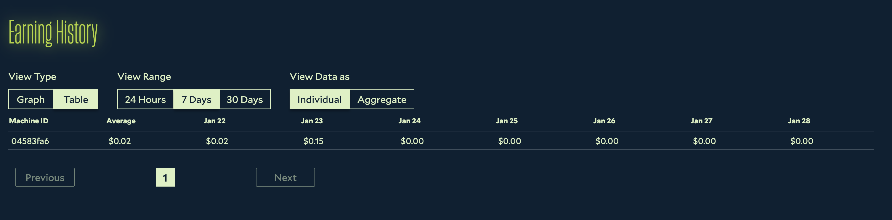

The earnings summary shows how much you have earned in total, the current earning rate of each of your machines, and
your earnings over time as a graph or a table. It also shows your total Chopping time and the number of rewards you have
redeemed.

Earnings are credited to your Salad Balance while a job runs, not only when it finishes, so the summary keeps moving
during a job. The numbers you see are based on the work your machine has reported; see
[How estimated earnings work](/faq/jobs/how-estimated-earnings-work) for why they can differ from the rate the app
displays.

## Opening the earnings summary

1. Open the Salad app.

   

2. Click your profile picture in the top left corner.

   

3. Click **Earnings History**.

   

4. The earnings summary opens in your web browser.

   

## Earning rate per machine

Near the top of the page, the **All Machines** section lists every machine on your account with its current earning rate
and when it was last seen. "Last seen" is the last time that machine earned any Salad Balance.

Machines are identified by their [Machine ID](/guides/using-salad/how-to-find-your-salad-machine-id); you can't name or
rename them.

## Earnings history as a graph

Scroll down to **Earning History** and select the **Graph** tab.

You can switch the timeframe between the last day, week and month, show earnings for the whole account or per machine,
and hover over the graph to see the amount at a specific point in time.

## Earnings history as a table

In the same section, select the **Table** tab.

The table offers the same timeframes and the same account or per-machine views; click an entry to see the earnings for
that period.

If a machine shows as running a job but its earnings are not moving, see
[Job running but no earnings](/troubleshooting/not-earning/job-running-but-no-earnings).
