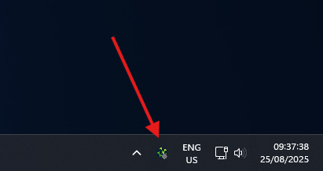

## What are Elevated Permissions?

Enabling Elevated Permissions lets Salad run some Windows-native workloads as an administrator. Salad only uses the
elevated rights when a workload needs them or when it will increase your earnings; everything else keeps running as
normal.

## Should I enable them?

Yes, for most Chefs. Elevated Permissions let Salad apply certain driver settings automatically that can raise your
earnings noticeably, and some workloads are only offered to machines that allow them. If you run an older AMD GPU (RX
400 or RX 500 series) we especially recommend enabling it, because those cards need
[compute mode](/guides/your-pc/how-to-enable-compute-mode-on-amd-drivers) and other driver tweaks to earn well.

## What are the risks?

A workload running with administrator rights could, in rare cases, hit an unexpected bug with side effects such as
taking longer to stop or continuing to run after Salad closes it. It also means third-party workloads run with admin
privileges on your PC. This is very unlikely, but if you prefer not to allow it you can leave the setting off. Depending
on your hardware and how you run Salad, that may reduce your earnings.

## How to enable Elevated Permissions

1. Open the Salad app.

   

2. Click your profile picture in the top left corner.

   

3. Click **Settings**.

   

4. Scroll down and open **Workload Preferences**.

   

5. Scroll down slightly and turn on **Allow Elevated Permissions**. Windows may show a User Account Control prompt;
   accept it.

For the rest of the settings on this page, see [Salad app settings](/guides/using-salad/salad-app-settings).
