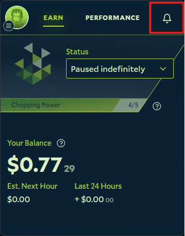
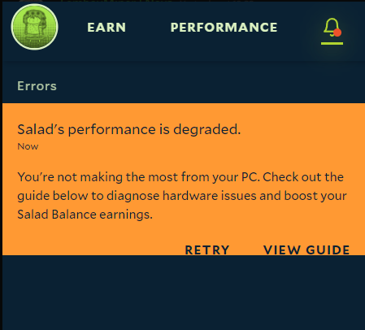

The notifications page lists every notification, error and message your Salad app has received. When something goes
wrong while Chopping, Salad sends a desktop notification and shows it on the **Earn** page of the app. Opening the
notification shows more detail and the actions you can take, such as a link to the guide that fixes the problem or a
button to retry a job.

To open the notifications page:

1. Open the Salad app.

   

2. Click the notification bell at the top right.

   

_Example of a degraded performance notification._

For what each Degraded State notification means and how to fix it, see
[Degraded State](/troubleshooting/degraded-state). Which notifications you receive is set under
[Notification Preferences](/guides/using-salad/salad-app-settings).
