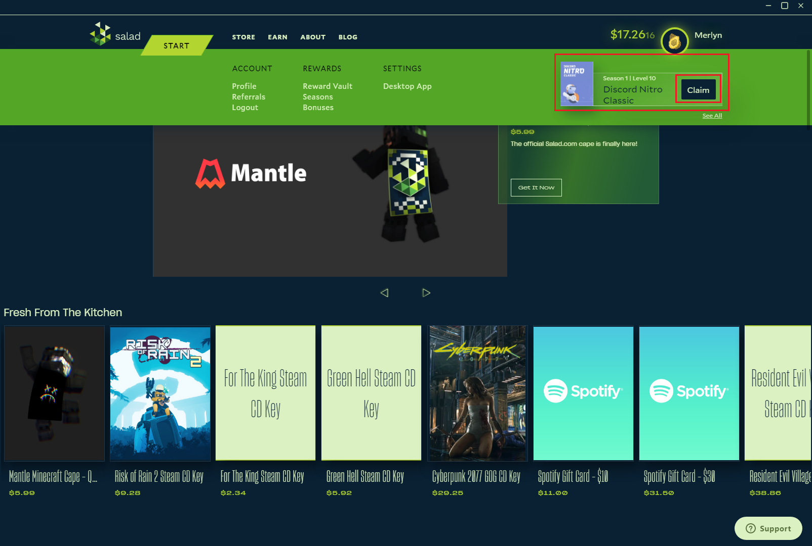
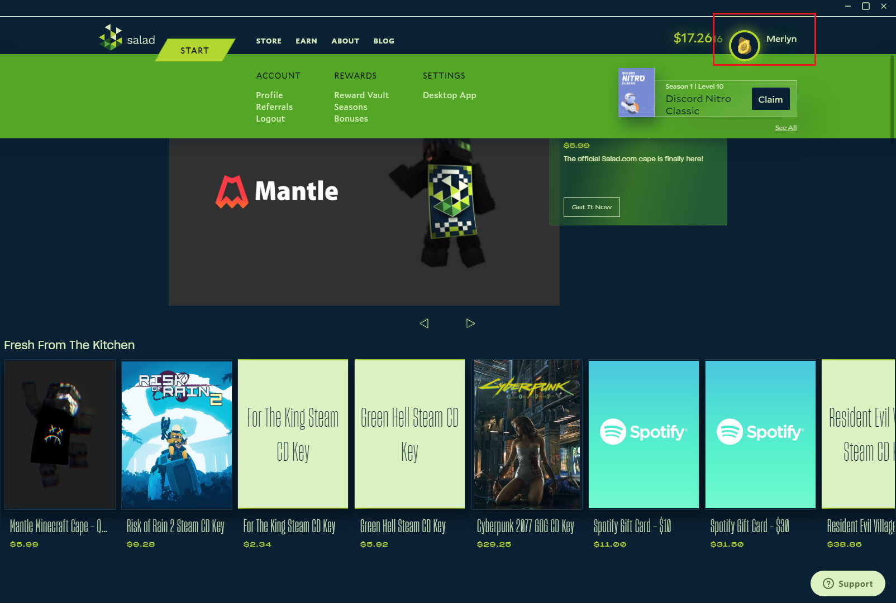
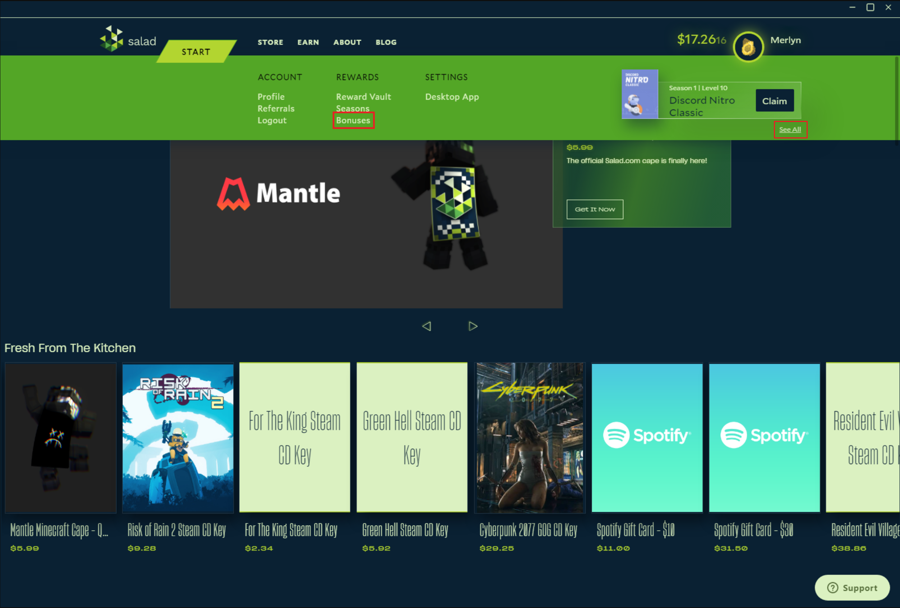
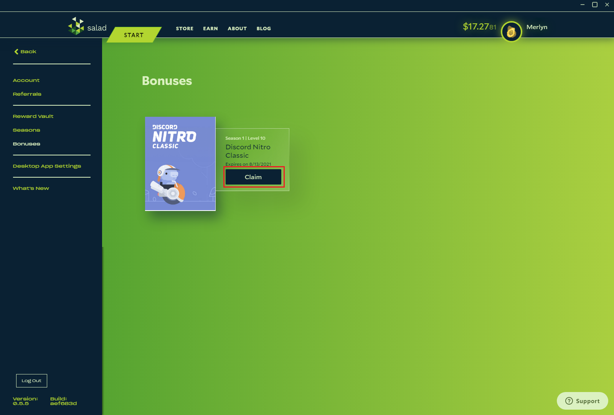

Bonuses are claimed on the Salad website.

## Claiming your most recent bonus

1. Hover over your profile at the top right to open the dropdown menu.

   

2. If one bonus is waiting, click **Claim** on the right of it to claim it directly from the menu.

   

## Claiming other bonuses

1. Hover over your profile to open the dropdown menu.

   

2. Click **Bonuses** in the middle column, or **See All** under a bonus already shown in the menu.

   

3. The page lists every bonus available to you. Click **Claim** on one to apply it to your account immediately.

   

## Good to know

- Claiming an earning multiplier while another is active **replaces** the active one; they don't stack. Salad asks you
  to confirm before replacing it.
- A claimed avatar is enabled from your profile; see
  [How to edit your profile](/guides/using-salad/how-to-edit-your-profile).
- A game key or reward claimed as a bonus goes to your Reward Vault; see
  [Reward Vault and redemption codes](/rewards/help/reward-vault-and-redemption-codes).
