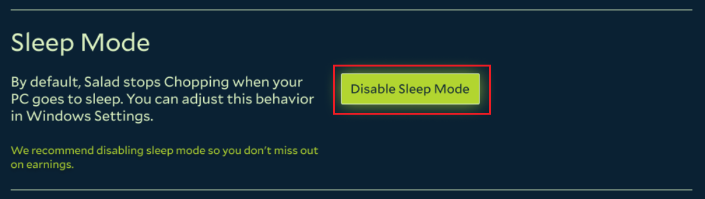

Windows puts your PC to sleep after a short period of inactivity, and nothing can run while it sleeps, so a job in
progress is interrupted. Disabling Sleep Mode in the Salad app keeps your PC awake while Salad runs. We recommend
turning it off on any PC you want to earn with.

1. Open the Salad app.

   

2. Click your profile picture in the top left corner.

   

3. Click **Settings**.

   

4. Find the Sleep Mode setting and click **Disable Sleep Mode**.

   

This only prevents automatic sleep while the PC is plugged in. A laptop running on battery still goes to sleep as
normal, and you can always put the PC to sleep manually.
