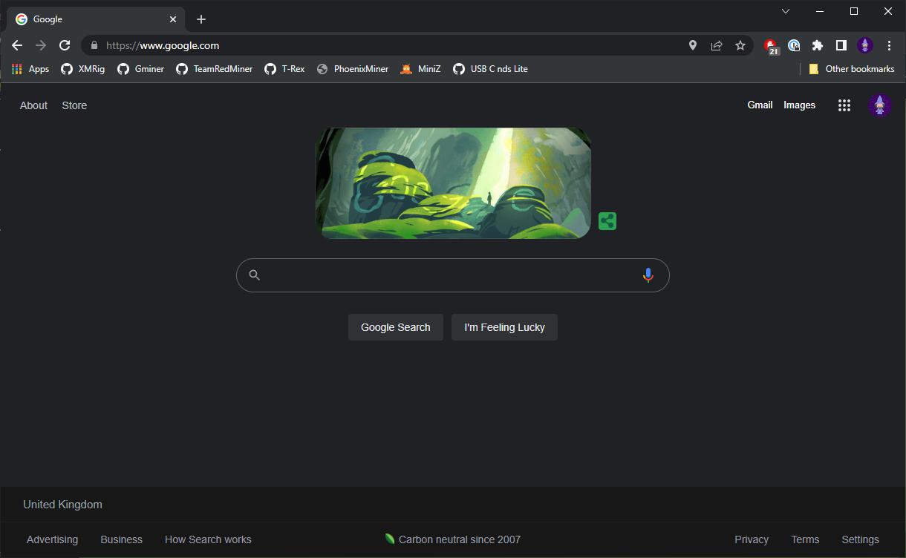
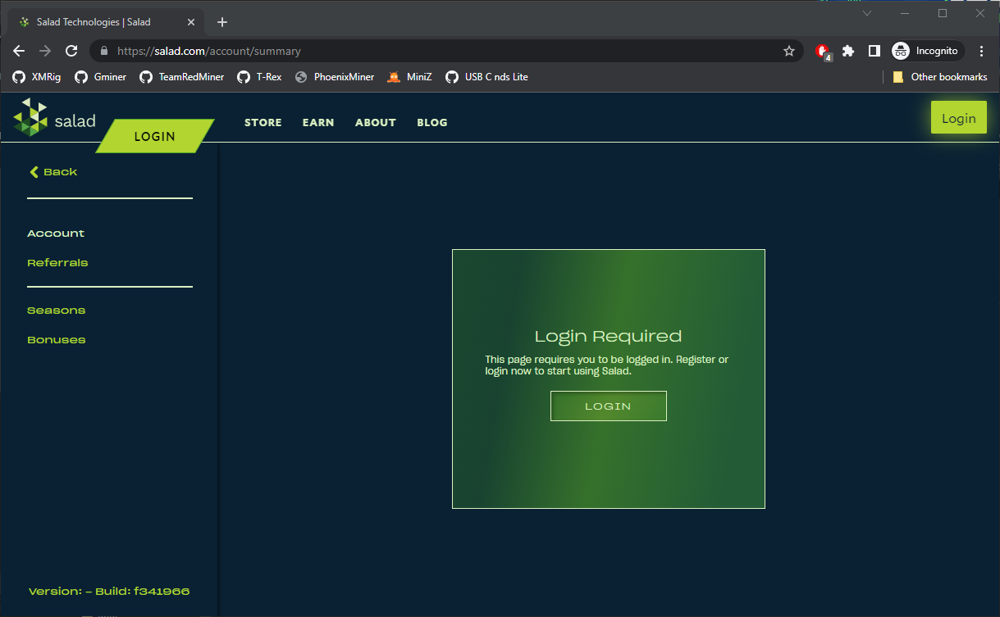
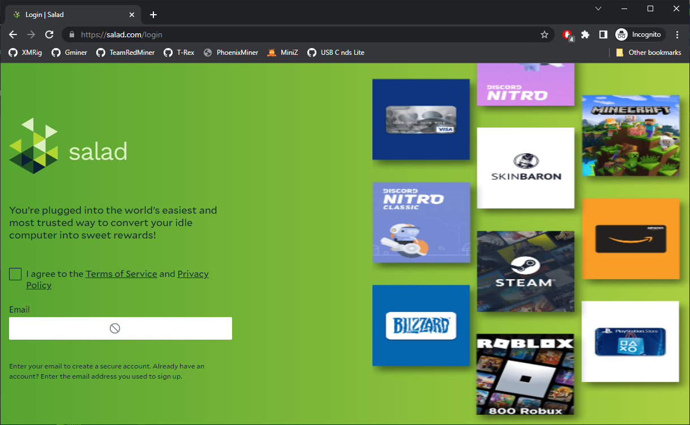
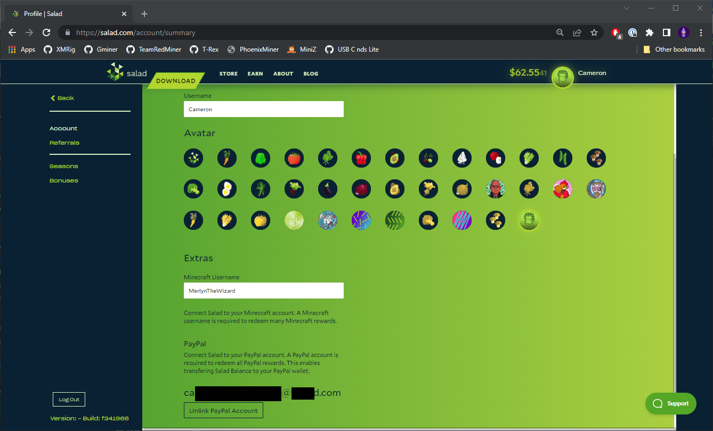

Your profile is managed on the Salad website, not in the app.

1. Open your web browser.

   

2. Go to [https://salad.com/account/summary](https://salad.com/account/summary).

   

3. Log in if you are not already logged in.

   

From your profile you can:

- Edit your Salad username.
- Change your avatar. A new avatar can take up to an hour to appear in the Salad app.
- Attach a Minecraft username, needed for some Minecraft rewards.
- Connect a Google account for Google sign-in.
- Add a [passkey](/guides/using-salad/salad-app-passkeys) to your account.

You cannot change the email address on your account; see
[Can I change the email address for my account?](/faq/your-account/can-i-change-the-email-address-for-my-account).
