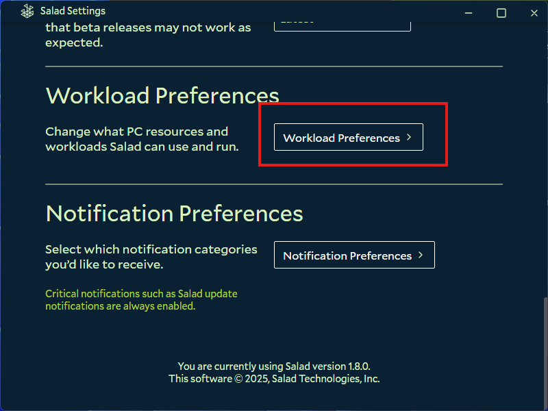
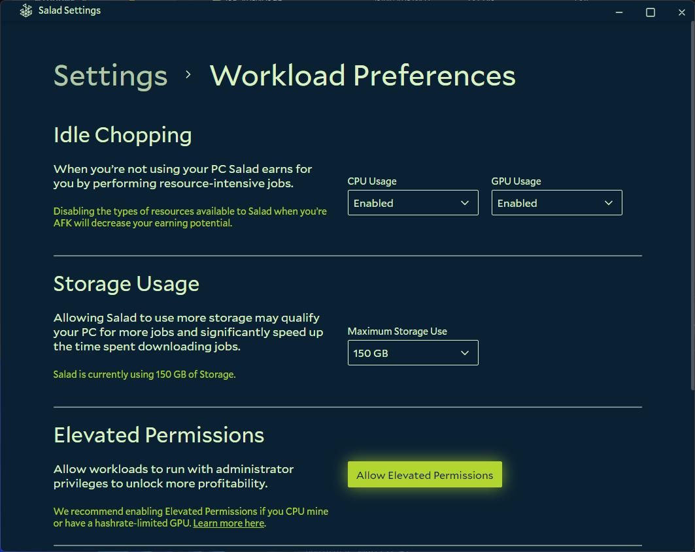

You choose which hardware Salad is allowed to share. To earn the most, enable everything: container jobs need both the
GPU and the CPU, and [Bandwidth Sharing](/faq/jobs/what-is-bandwidth-sharing) adds jobs that don't depend on your GPU at
all.

1. Open the Salad app.

   

2. Click your profile in the top left corner.

   

3. Choose **Settings** from the dropdown.
4. Scroll down and open **Workload Preferences**.

   

5. Under **Idle Chopping**, enable or disable your CPU and GPU from the dropdown menus. Scroll further to **Workload
   Types** and make sure every job type you are happy to run is toggled on too.

   

## Which GPUs can earn

- Integrated graphics (the GPU built into your CPU or laptop chipset) cannot earn on Salad. Only a dedicated graphics
  card does.
- If you have two dedicated GPUs, Salad only uses one of them. See
  [Can I use multiple GPUs?](/faq/compatibility/can-i-use-multiple-gpus).
- If Salad shows the wrong card or none at all, see
  [What GPU or CPU is Salad detecting?](/guides/your-pc/what-gpu-or-cpu-is-salad-detecting).

For what each setting on this page does, see [Salad app settings](/guides/using-salad/salad-app-settings).
