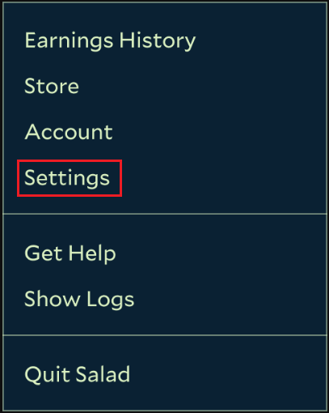
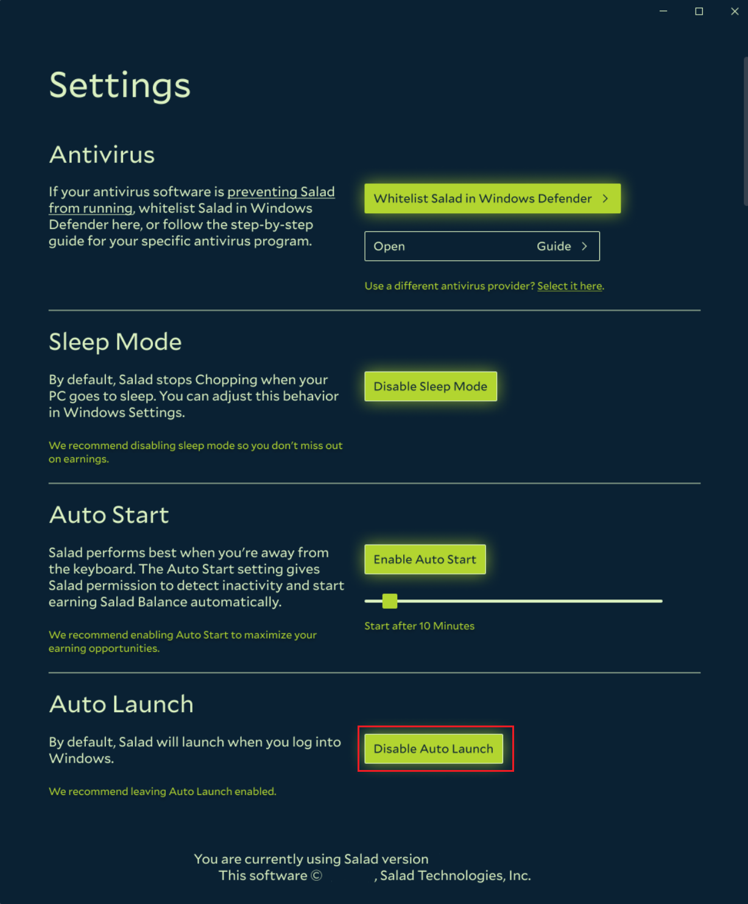

Auto Launch opens the Salad app when your PC boots. Combined with
[Auto Start](/guides/using-salad/how-to-enable-auto-start), it lets Salad begin Chopping on its own whenever you are
away from your PC. It is **enabled** by default; follow these steps to turn it off or back on.

1. Open the Salad app.

   

2. Click your profile picture in the top left corner.

   

3. Click **Settings**.

   

4. Near the bottom of the page, find **Auto Launch** and click **Disable Auto Launch** (or **Enable Auto Launch**).

   
