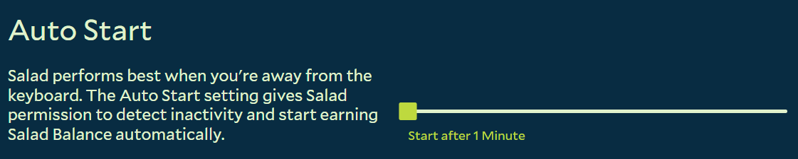

Auto Start makes Salad begin Chopping automatically once your PC has been idle for a set time, so you earn Salad Balance
whenever you step away. By default Salad waits 10 minutes; adjust it to match how you use your PC.

1. Open the Salad app.
   
2. Click your profile icon in the top left corner and choose **Settings**.
   
3. Scroll down to **Auto Start** (in the Idle Chopping section).
4. Drag the **Start After** slider to the number of minutes your PC must be idle before Salad starts. A shorter time
   means you start earning sooner after you leave.
   

Salad detects idleness from your mouse and keyboard activity, and any movement resets the timer. If you often have short
pauses where you don't want Salad to start, pick a slightly longer delay.

Auto Start only works while the Salad app is open, so keep [Auto Launch](/guides/using-salad/how-to-enable-auto-launch)
enabled too. If Salad should not start on its own at all, choose **Pause Indefinitely** in the app; see
[Salad's running states](/guides/using-salad/salads-different-running-states).
