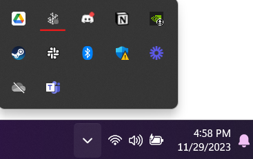
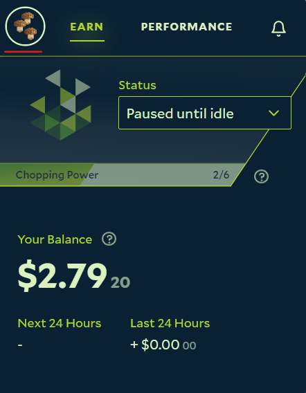
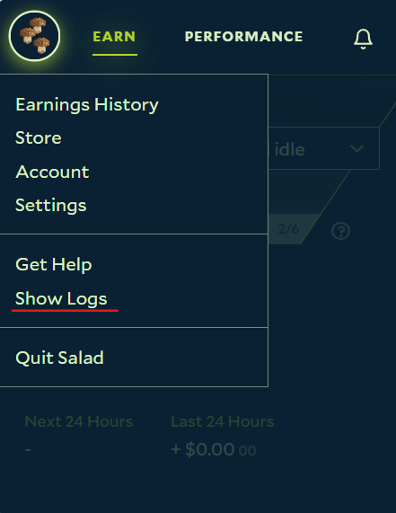
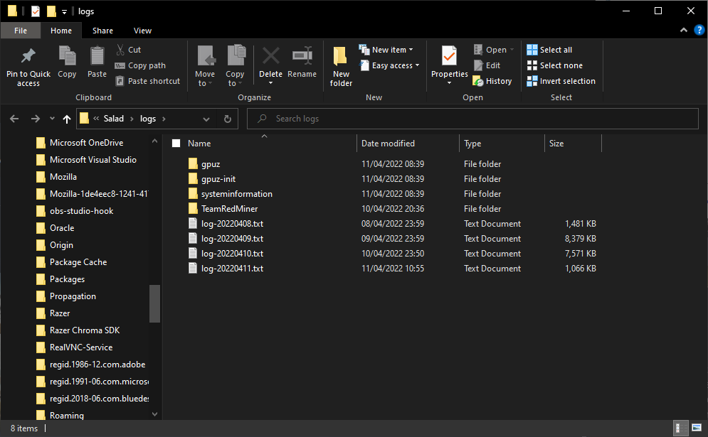

When you contact Salad Support about a problem, you will usually be asked for your log files. Support needs the **whole
logs folder, zipped**, not a single file: the different subfolders record different parts of Salad and the problem is
often only visible in one of them.

Logs rotate after a short time and older entries are discarded, so collect and send them **as soon as possible after the
problem happens**. Logs taken days later may no longer contain the moment that went wrong.

## Get your logs from the Salad app

1. Open the Salad app.
   
2. Click the menu at the top left.
   
3. Scroll down and click **Show Logs**.
   
4. A File Explorer window opens on the `logs` folder. Go up one level, right-click the `logs` folder and choose
   **Compress to ZIP file** (or **Send to > Compressed (zipped) folder**). Attach the resulting zip to your
   [support ticket](/guides/your-pc/how-to-create-a-support-ticket).

## Find the logs folder manually

If the button does not work, open File Explorer and go to:



```
C:\Users\<username>\AppData\Roaming\Salad\logs
```

Replace `<username>` with your Windows user name. The `AppData` folder is hidden by default; paste the path into the
address bar, or type `%APPDATA%\Salad\logs` and press Enter. Zip the whole `logs` folder as above.

## What is in the logs folder

You don't need to pick files out, but it helps to know what is there:

- The files in the root of the folder are the main Salad app logs. Support asks for these for most app and job problems.
- `gpuz` and `gpuz-init` record the GPU sensor data (temperature, usage) and which GPUs were detected. They matter when
  a GPU is missing from the app.
- `systeminformation` records the CPU and RAM Salad detected.
- Other folders named after a workload (for example a miner name) hold that workload's own logs.

Zipping the whole folder sends all of them at once, which is why support asks for it.
