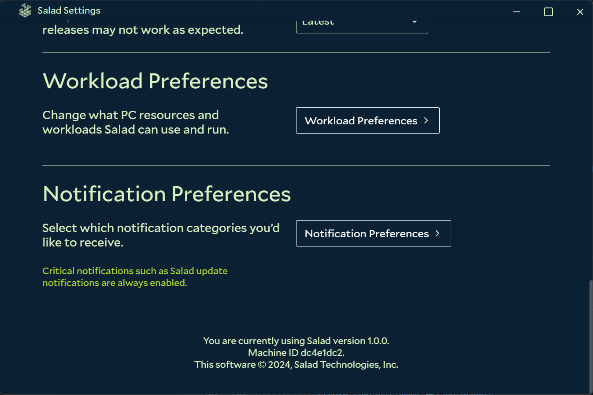
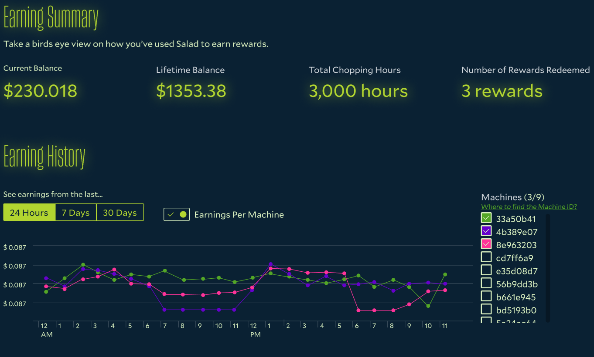

Every PC registered to your account gets a Salad machine ID. Support uses it to look up your machine, so when you
contact [Salad Support](/contact) about a problem, include it. Support only needs the **first 8 characters** of the ID.

## In the Salad app

1. Open the Salad app.
2. Click the app menu in the top left corner and open **Settings**.
3. Scroll to the bottom of the Settings page. The machine ID is listed there, next to the current Salad version.

## On the earnings summary

The [earnings summary](/guides/using-salad/earnings-summary) lists every machine on your account by its machine ID, so
you can also find it there, and use it to tell your machines apart when breaking earnings down per machine.

You may see machine IDs you don't recognize. This happens when one of your PCs runs an older version of Salad, or after
a hardware change, which gives the PC a new ID.
