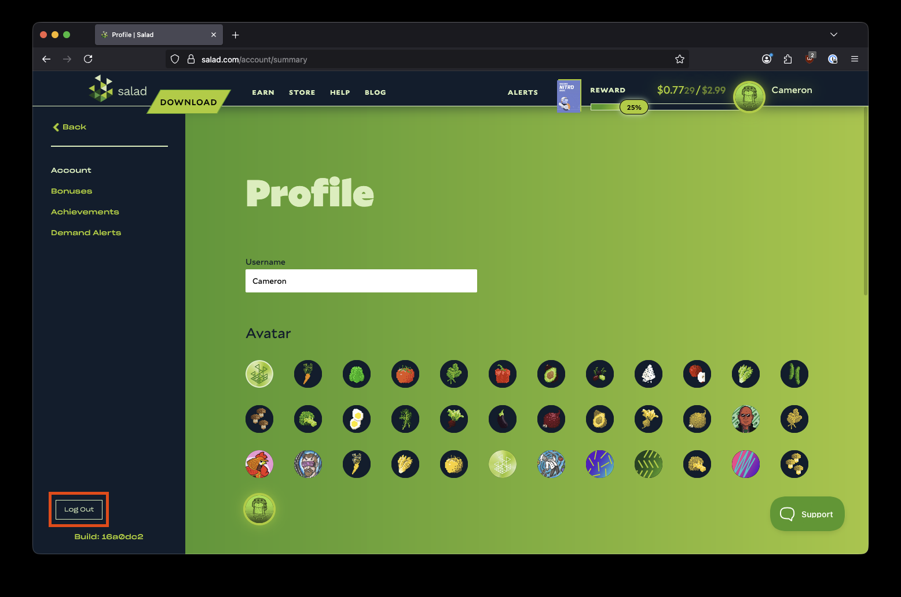

1. Open your web browser and go to [https://salad.com/account/summary](https://salad.com/account/summary).
2. Click **Log Out** at the bottom left of the page.

   

Logging out of the website does not stop the Salad app from Chopping. To stop the app, see
[Salad's running states](/guides/using-salad/salads-different-running-states).

Logging out to switch between several accounts is a breach of the Terms of Service and leads to the accounts being
banned; see [Can I create multiple accounts?](/faq/your-account/can-i-create-multiple-accounts).
