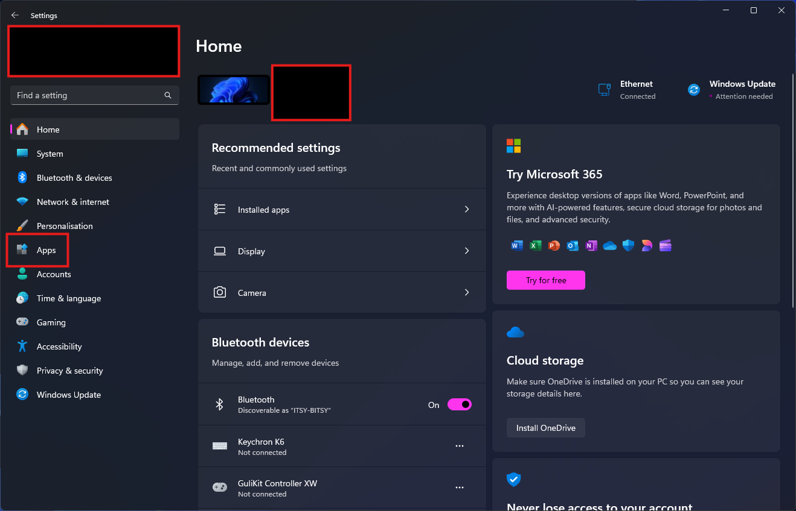
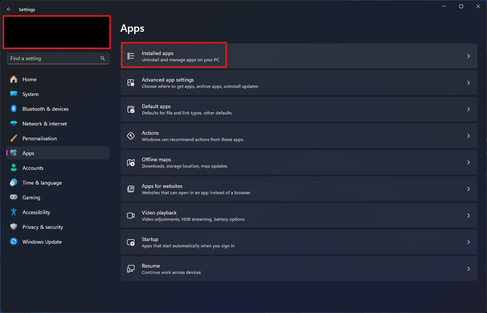
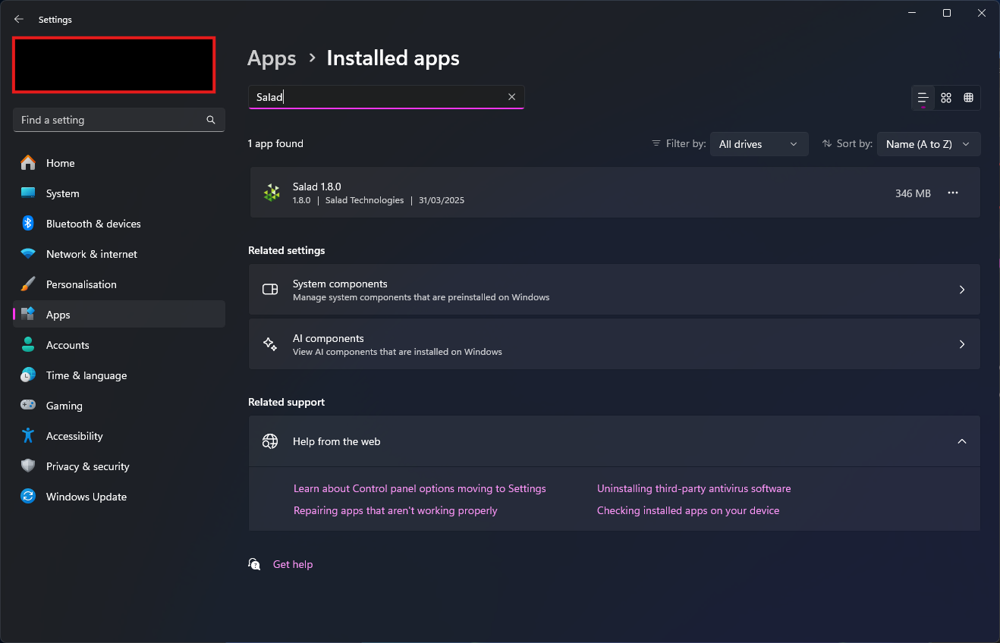

<Callout type="warn" title="Reinstalling rarely fixes Degraded State">
  If you are uninstalling because of a Degraded State notification, reinstalling the app almost never fixes it: those
  notifications point at your drivers, Windows features or hardware, not at the app files. Follow the guide for your
  notification in [Degraded State](/troubleshooting/degraded-state) first and reinstall only as a last step.
</Callout>

1. Open Windows Settings and go to **Apps**.

   

2. Click **Installed apps**.

   

3. Use the search bar to find Salad.

   

4. Click Salad, click **Uninstall**, then **Uninstall** again.
5. Let the uninstaller run; it removes the application from your PC.
6. Restart your PC to finish.

Uninstalling the app does not delete your account or your Salad Balance. If you want to leave Salad entirely, see
[How can I delete my account?](/faq/your-account/how-can-i-delete-my-account).
