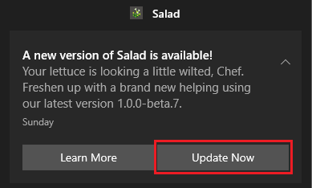

When a new version of the Salad app is available, Salad tells you with a desktop notification. Click **Update Now** to
install it; the app restarts on the new version. **Learn More** opens the What's New page with the change log.

Updates are only offered for the [update channel](/guides/using-salad/salad-app-settings) you have selected. If an
update keeps failing, download the latest installer from the
[official sources](/guides/getting-started/downloading-salad) and run it over your existing installation.
