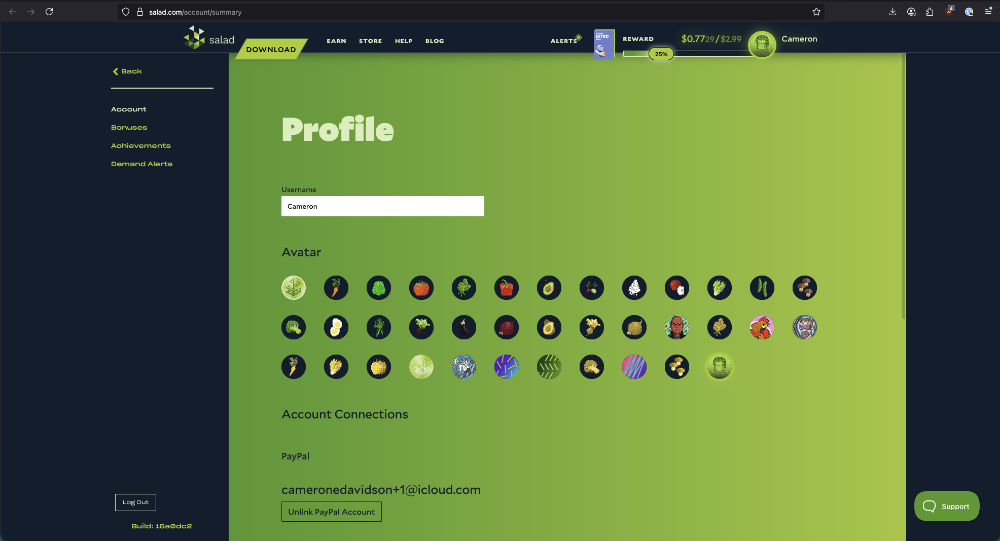
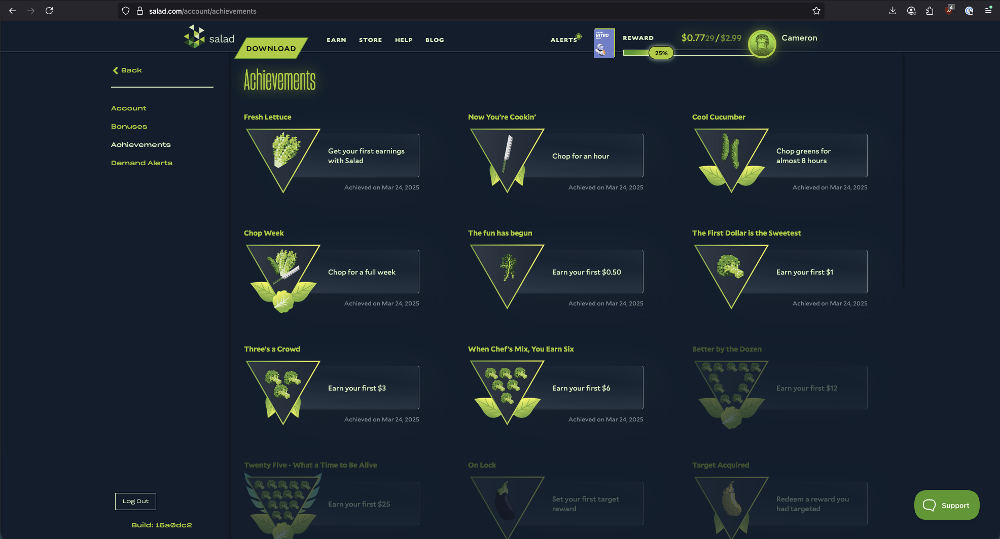

Achievements are earned by completing tasks and goals while using Salad. You can see them, and when you earned them, on
the Salad website.

1. Open your [Salad account profile](https://salad.com/account/summary) in your web browser.
   
2. Log in if you are not already logged in.
3. In the left-hand menu, select **Achievements**.
   

The page lists every achievement you have earned with the date you earned it, plus the ones you have yet to unlock and
what you need to do for each.
