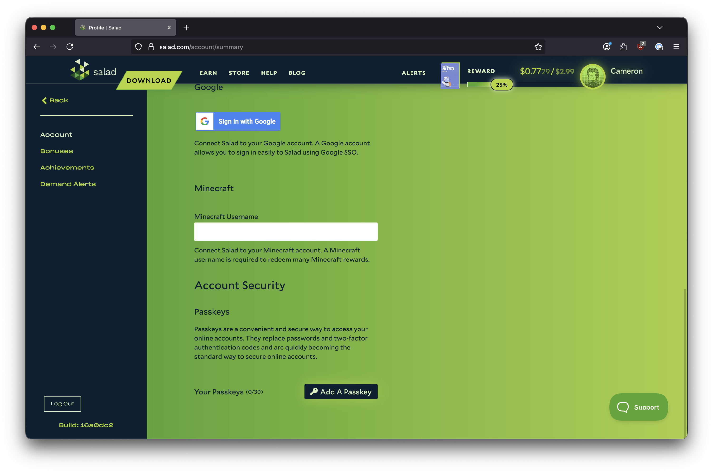

A passkey protects your Salad account with your device's own unlock method (fingerprint, face or PIN) instead of a
one-time email code. Passkeys are optional and you add them yourself from the Salad website.

**To set up a passkey:**

1. Go to the [Salad web app](https://salad.com/account/summary) and scroll down to **Account Security**.
2. Click **Add a passkey**.

   

3. Complete the one-time passcode challenge that appears.
4. Follow your browser's prompts. When it finishes, the page shows a passkey has been added for your browser and gives
   you a set of **backup codes**.

<Callout type="warn" title="Salad cannot remove a passkey">
  Once a passkey is set up, Salad Support cannot edit, remove or bypass it. The only ways into a passkey-protected
  account are the passkey itself or the backup codes you were given when you added it. If you lose both, see [I lost my
  passkey](/troubleshooting/connection-and-login/i-lost-my-passkey).
</Callout>

Save your backup codes somewhere **outside the PC you run Salad on**: a password manager, a note on your phone, a
printout, or a USB stick kept elsewhere. Keep more than one copy. If your Salad PC breaks or gets reinstalled and the
codes were only stored on it, you lose access to your account.

Having trouble signing in with a passkey? See
[Passkey troubleshooting](/troubleshooting/connection-and-login/passkey-troubleshooting). To learn more about how
passkeys work in general, see
[Microsoft's passkey overview](https://www.microsoft.com/en-gb/security/business/security-101/what-is-passkey).
