The Salad app's settings control when it Chops, which hardware and job types it uses, and which notifications you get.
To open them, click your profile in the top left corner of the app and choose **Settings**.

Most Chefs never need to change anything after setup. This page explains each option so you know what it does before you
touch it.

## Anti-Virus

Shows whether Salad has been whitelisted in your antivirus and helps you do it if it was skipped during onboarding.
Change it if your antivirus keeps quarantining Salad files or jobs keep failing. See
[Whitelisting Salad](/troubleshooting/antivirus) for product-specific steps.

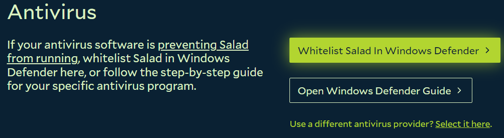

## Sleep Mode

Salad stops Chopping when Windows puts your PC to sleep. Turning Sleep Mode off here keeps the PC awake while Salad is
running, so jobs don't get cut off. Change it if you see jobs stopping whenever you step away. See
[How to disable sleep mode](/guides/using-salad/how-to-disable-sleep-mode).

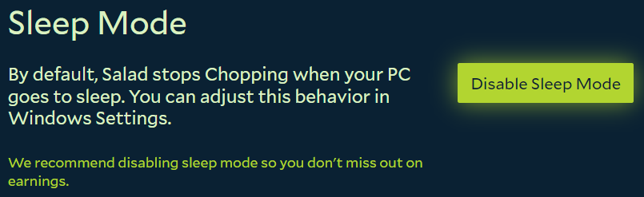

## Auto Start

Salad can start Chopping on its own once your PC has been idle for a set time. Pick a shorter delay if you want Salad to
jump in as soon as you walk away, or a longer one if it keeps starting while you are still reading. See
[How to enable auto start](/guides/using-salad/how-to-enable-auto-start).

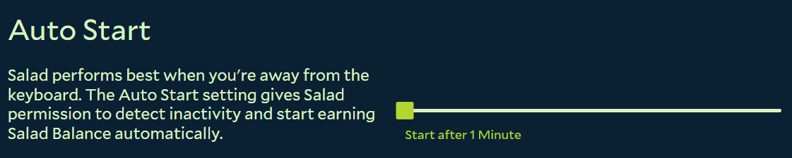

## Auto Launch

Opens the Salad app automatically when you log into Windows. Leave it on if you want Salad to earn without you thinking
about it; turn it off if you only run Salad occasionally. See
[How to enable auto launch](/guides/using-salad/how-to-enable-auto-launch).

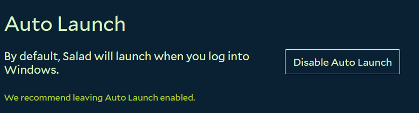

## Update Channel

Chooses between the stable release and beta builds. Stay on stable unless you want to try new features early and don't
mind the occasional bug.

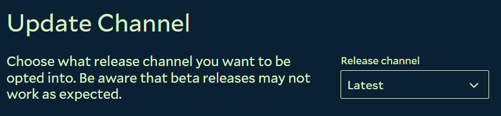

---

## Workload Preferences

These settings decide which hardware Salad uses and which kinds of jobs it accepts. Broader settings mean more jobs to
choose from. See [Workload preferences](/guides/getting-jobs/workload-preferences) for the job-type toggles.

### Idle Chopping

Enables or disables your GPU and CPU for Chopping. Keep both enabled: container jobs need the GPU and the CPU together.
Change it only if you need to keep one component free for something else. See
[How to enable and disable hardware](/guides/using-salad/how-to-enable-and-disable-hardware).

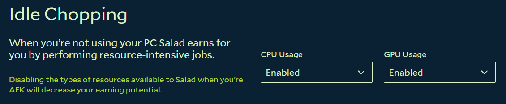

### Elevated Permissions

Lets Salad run with administrator rights so it can manage the container environment and apply GPU settings that some
jobs need. Enable it if Salad asks you to or if you see Degraded State notifications about it. See
[Elevated permissions](/guides/using-salad/elevated-permissions).

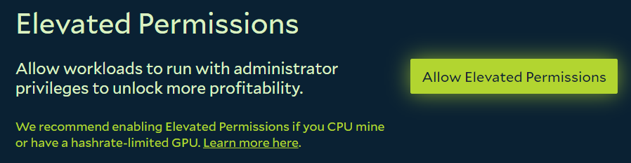

### Job Types

Lets Salad pick the most profitable jobs for your machine, or lets you opt out of specific types. Opting out reduces how
often you get a job, so only turn a type off if you have a reason to.

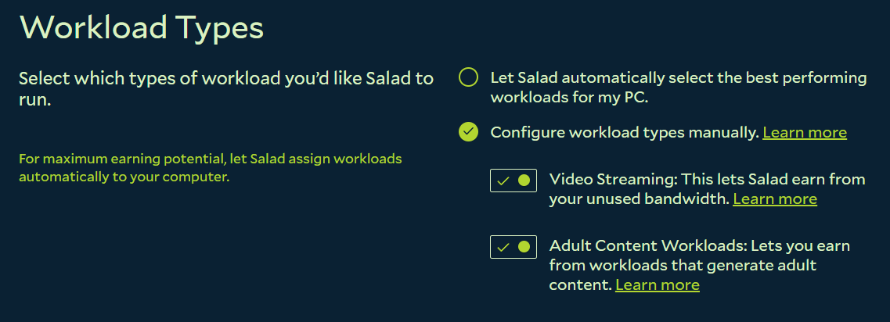

---

## Advanced Options

Settings for Chefs who want finer control over when Salad runs.

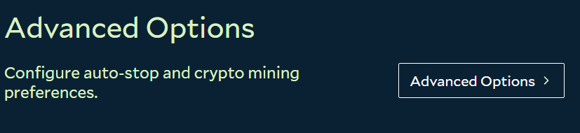

### Auto-Stop

By default Salad stops when it detects you using the PC. Turning Auto-Stop off keeps Salad Chopping through your
activity. Change it if you are happy to share your PC while you use it for light tasks; leave it on if you game or use
the GPU.

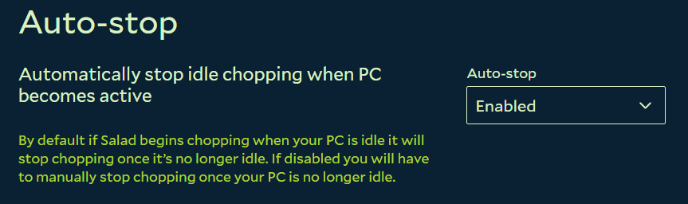

### Crypto Mining

Allows or blocks crypto mining jobs. Mining is a backup workload: it only runs when no container job is available for
your machine, and it pays very little on modern cards. You can turn it off here (under Workload Types) if you don't want
it; your container jobs are unaffected. See [Mining as a backup workload](/faq/jobs/mining-as-a-backup-workload).

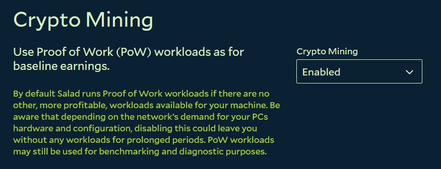

### Scheduled Chopping

Sets a weekly schedule for when Salad starts and stops. Use it if you only want Salad running overnight or while you are
at work. See [Schedule chopping](/guides/using-salad/schedule-chopping).

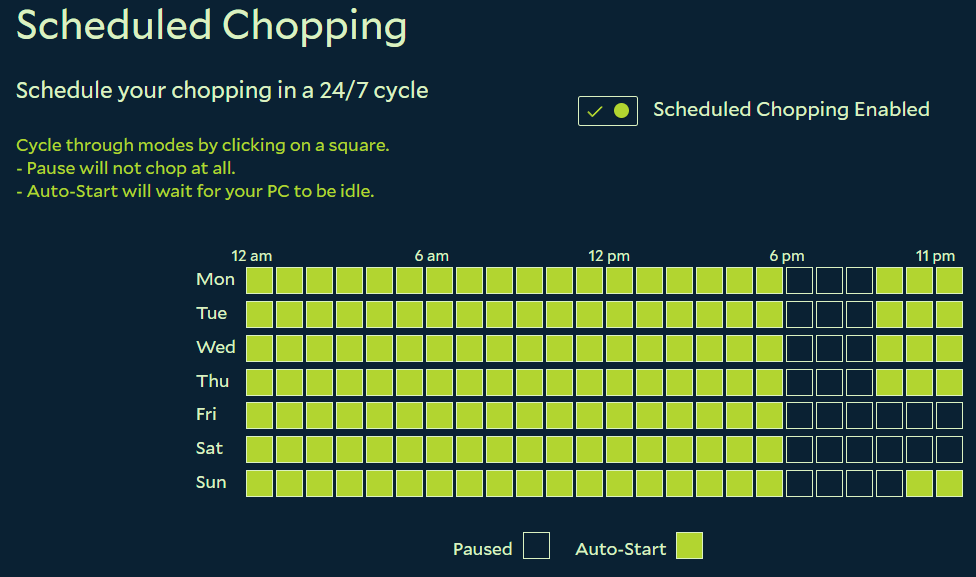

---

## Notification Preferences

Choose which notifications Salad sends you. See
[How does the notifications page work?](/guides/using-salad/how-does-the-notifications-page-work).

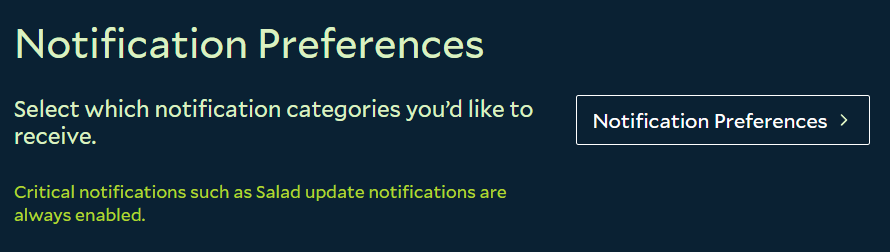

### Account Activity

Account-related updates such as Chopping Power changes and Target Reward progress.

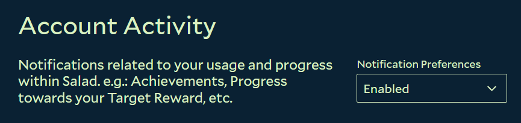

### Promos

Storefront sales, new rewards and Salad partnerships.

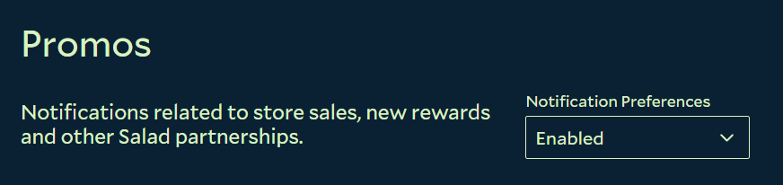

### Community

Surveys, support outreach and community events.

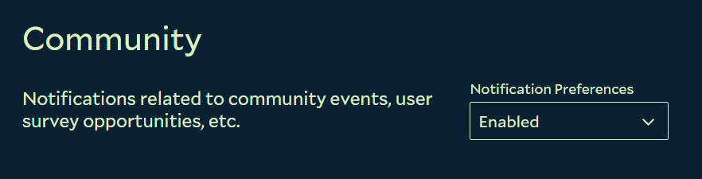
