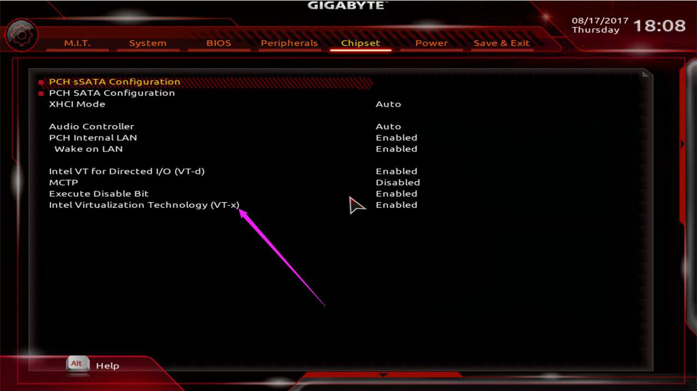
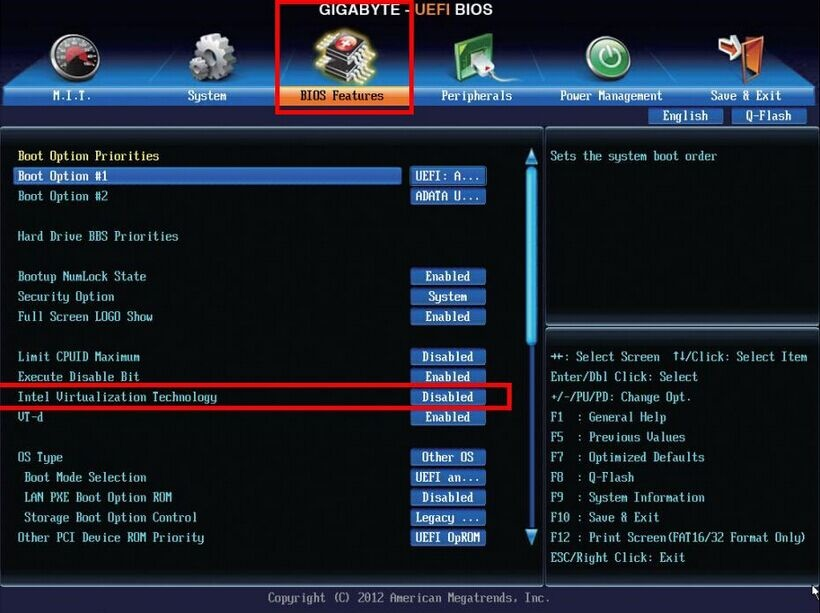
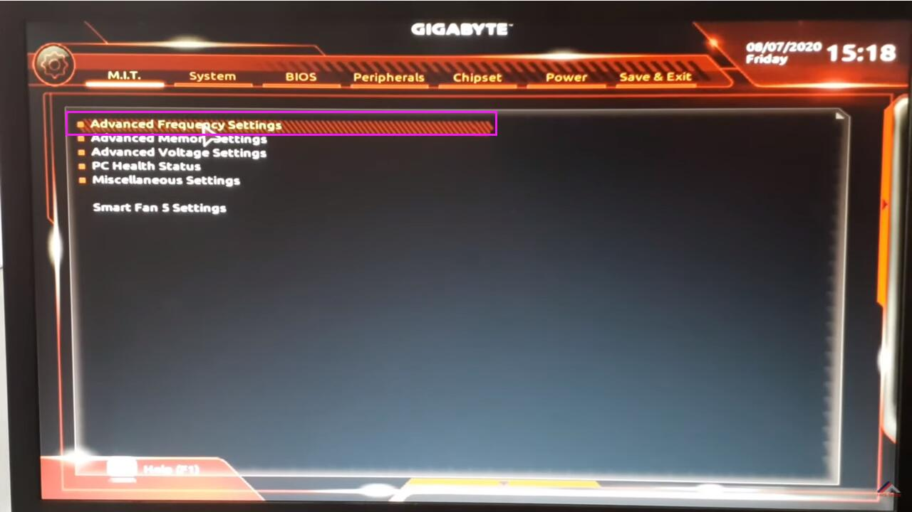
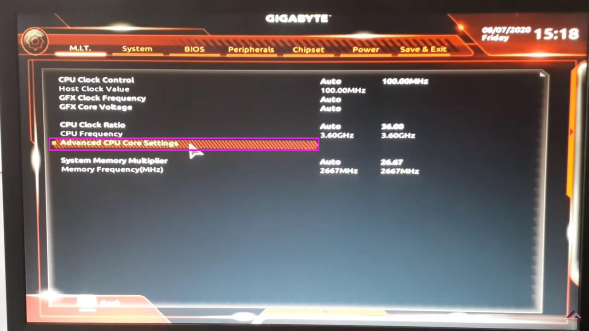
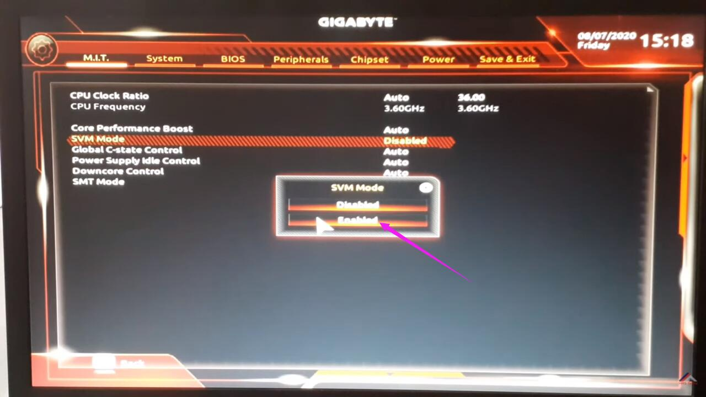
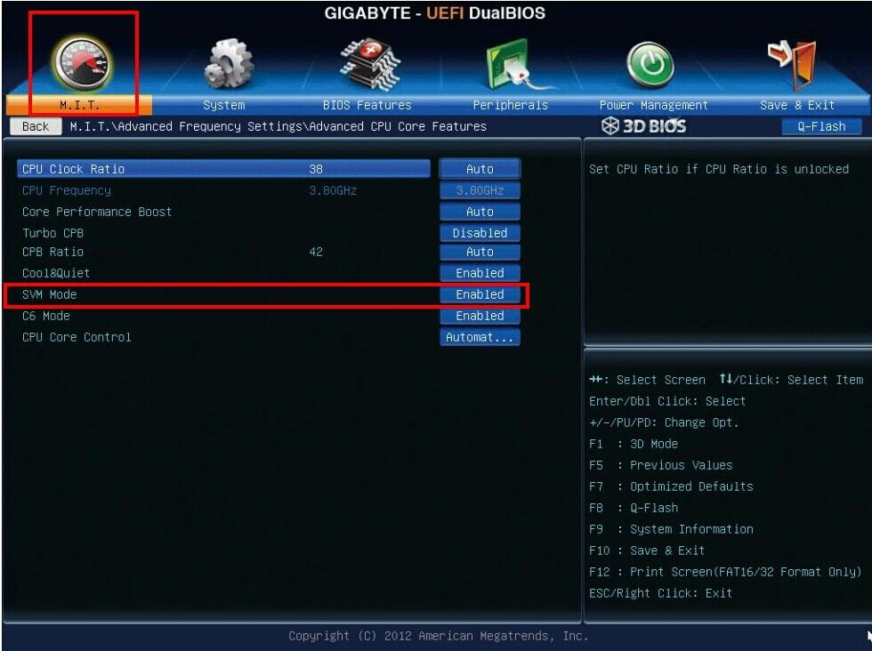

These steps cover Gigabyte motherboards. The setup key is shown on the Gigabyte splash screen; if none is shown, use
**Del**. Not sure which board you have? See
[Identifying your motherboard](/guides/your-pc/identifying-your-motherboard). General guidance is in
[How to enable virtualization support](/guides/your-pc/how-to-enable-virtualization-support-on-your-machine).

## Intel processors

1. Restart your PC and press the setup key (usually **Del**) repeatedly as it boots.
2. Open the **BIOS Features** tab. On some boards the setting is under the **Chipset** tab instead.
3. Find **Intel Virtualization Technology** (also shown as **VT-x**, **Intel VT**, **VT-d** or simply
   **Virtualization**).

   ([source](https://www.ldplayer.net/blog/enable-virtualization-technology-on-gigabyte-computer-and-motherboard.html))
   ([source](https://www.ldplayer.net/blog/enable-virtualization-technology-on-gigabyte-computer-and-motherboard.html))

4. Set every virtualization option you find to **Enabled**.
5. Press **F10** to save and exit.

## AMD processors

1. Restart your PC and press the setup key (usually **Del**) repeatedly as it boots.
2. Open the **M.I.T.** tab, then **Advanced Frequency Settings**.

   ([source](https://www.ldplayer.net/blog/enable-virtualization-technology-on-gigabyte-computer-and-motherboard.html))

3. Open **Advanced CPU Core Settings**.

   ([source](https://www.ldplayer.net/blog/enable-virtualization-technology-on-gigabyte-computer-and-motherboard.html))

4. Set **SVM Mode** to **Enabled**. On newer boards the same setting is under **Tweaker > Advanced CPU Settings**.

   ([source](https://www.ldplayer.net/blog/enable-virtualization-technology-on-gigabyte-computer-and-motherboard.html))

   ([source](https://www.ldplayer.net/blog/enable-virtualization-technology-on-gigabyte-computer-and-motherboard.html))

5. Press **F10** to save and exit.
