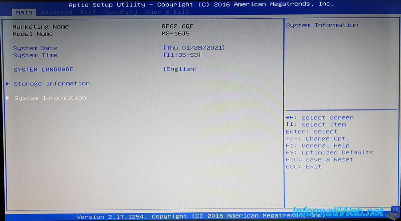
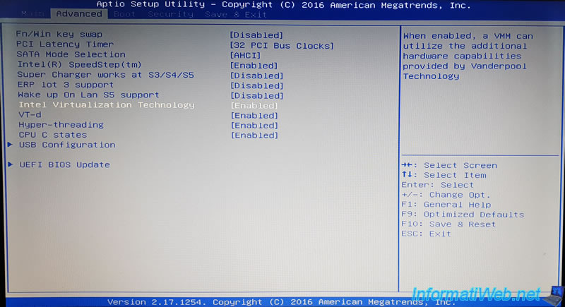
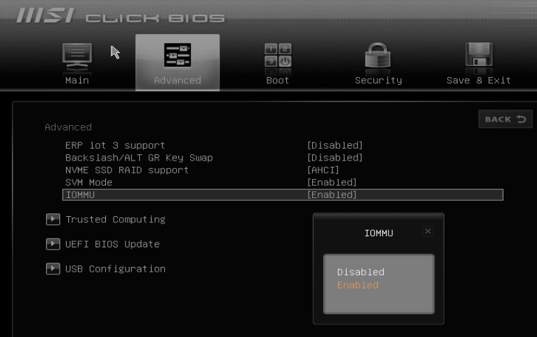
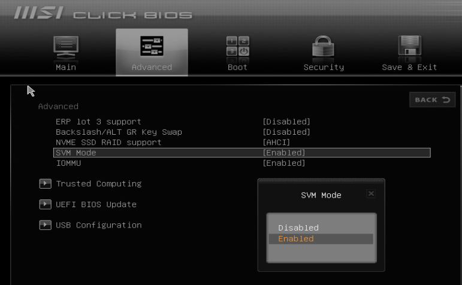
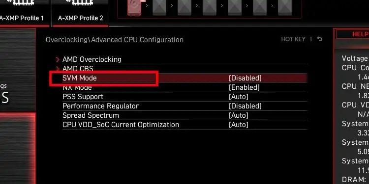

These steps cover MSI motherboards, which use the American Megatrends (Aptio) BIOS. The setup key is **Del**. Not sure
which board you have? See [Identifying your motherboard](/guides/your-pc/identifying-your-motherboard). General guidance
is in [How to enable virtualization support](/guides/your-pc/how-to-enable-virtualization-support-on-your-machine).

## Intel processors

1. Restart your PC and press **Del** repeatedly as it boots. The BIOS shows "Aptio Setup Utility – American Megatrends,
   Inc." at the top.

   

2. Open the **Advanced** tab and scroll to **Intel Virtualization Technology**.

   

3. Set it to **Enabled**.
4. Press **F10** to save and exit.

## AMD processors

On most MSI boards with an AMD CPU, virtualization is already enabled. If it is not:

1. Restart your PC and press **Del** repeatedly as it boots.
2. Open the **Advanced** tab.
3. Set **IOMMU** to **Enabled**.

   

4. Set **SVM Mode** to **Enabled**.

   

   On newer MSI boards (Click BIOS 5), SVM Mode is under the **OC** (Overclocking) tab, in **Advanced CPU
   Configuration**.

   

5. Press **F10** to save and exit.
