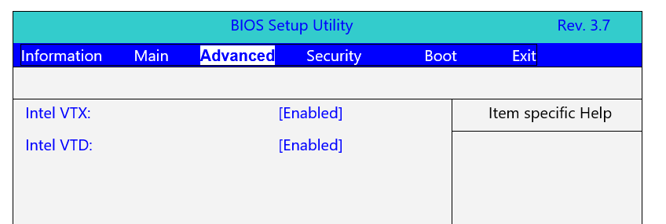
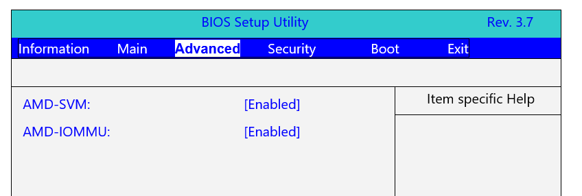

These steps cover Acer prebuilt desktops and laptops. The setup key is **F2**. Not sure which CPU you have? See
[Identifying your CPU](/guides/your-pc/identifying-your-cpu). General guidance is in
[How to enable virtualization support](/guides/your-pc/how-to-enable-virtualization-support-on-your-machine).

## Intel processors

1. Restart your PC and press **F2** repeatedly as it boots to open the BIOS Setup Utility.

   

2. Use the arrow keys to open the **Advanced** tab.
3. Enable both **Intel VTX** and **Intel VTXD**. On some models these settings are hidden until you press **Ctrl + S**.
4. Press **F10** to save and exit.

## AMD processors

1. Restart your PC and press **F2** repeatedly as it boots to open the BIOS Setup Utility.

   

2. Use the arrow keys to open the **Advanced** tab.
3. Enable both **AMD-SVM** and **AMD-IOMMU**. On some models these settings are hidden until you press **Ctrl + S**.
4. Press **F10** to save and exit.
