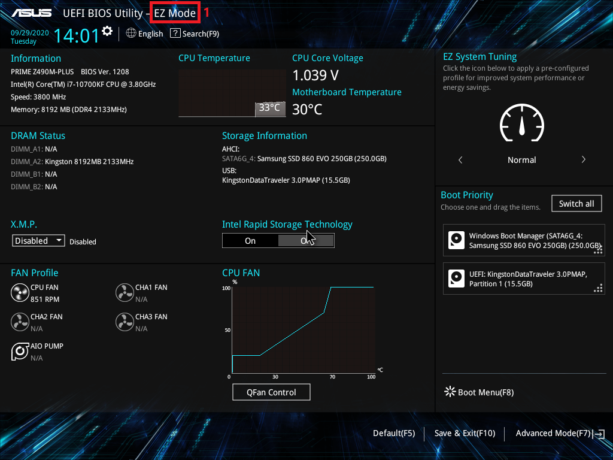
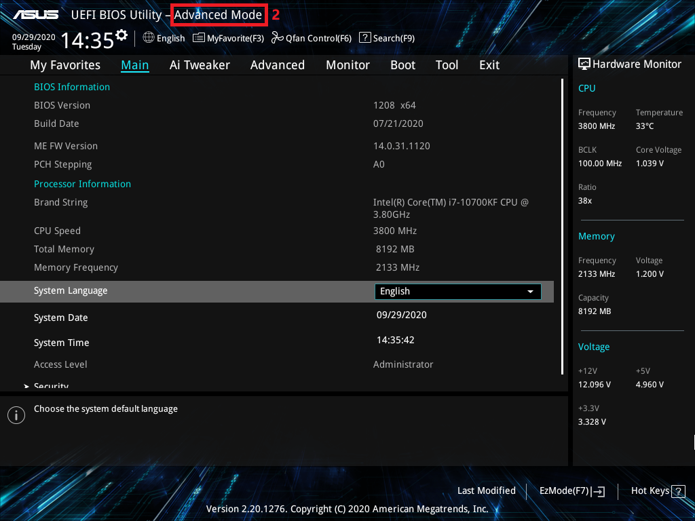
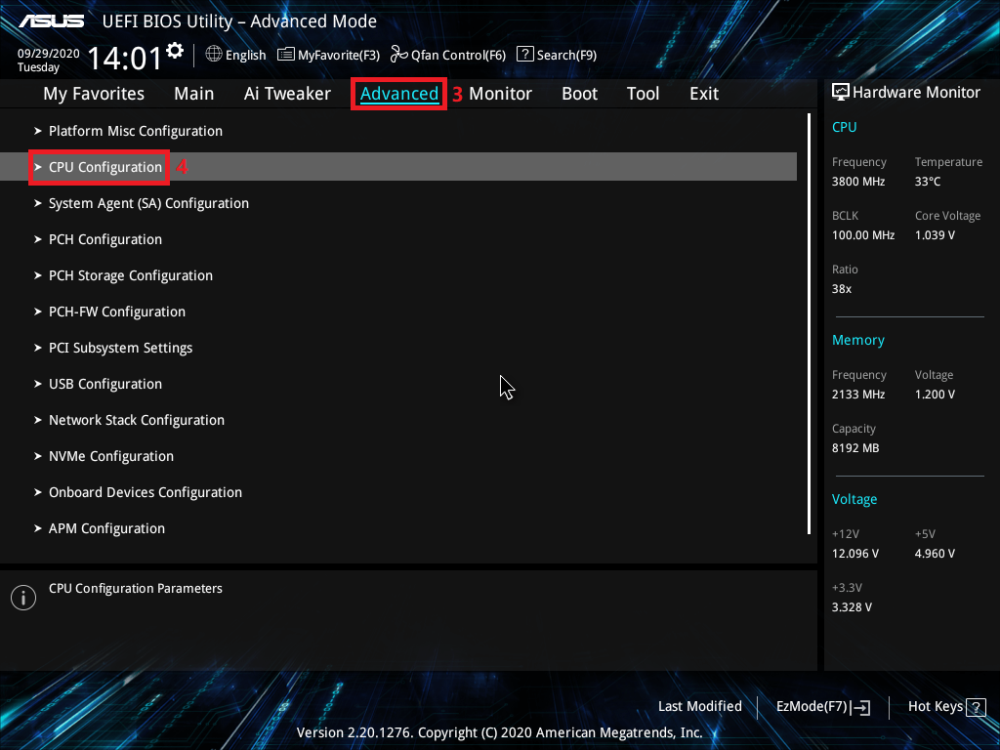
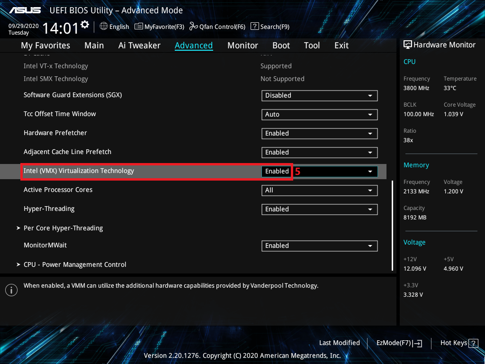
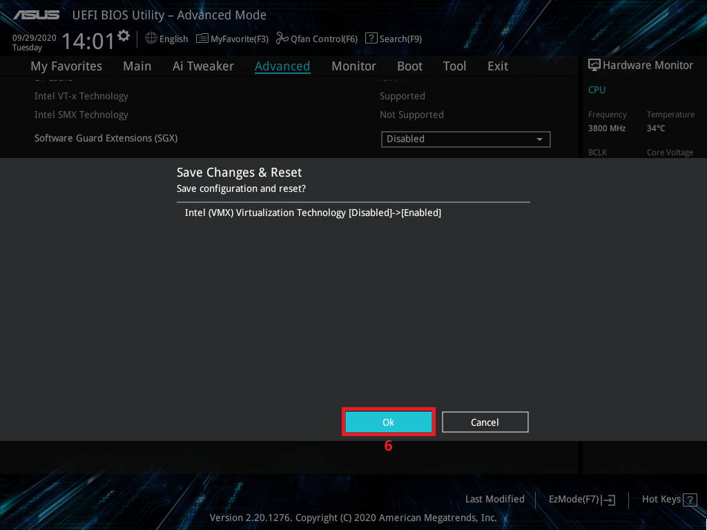
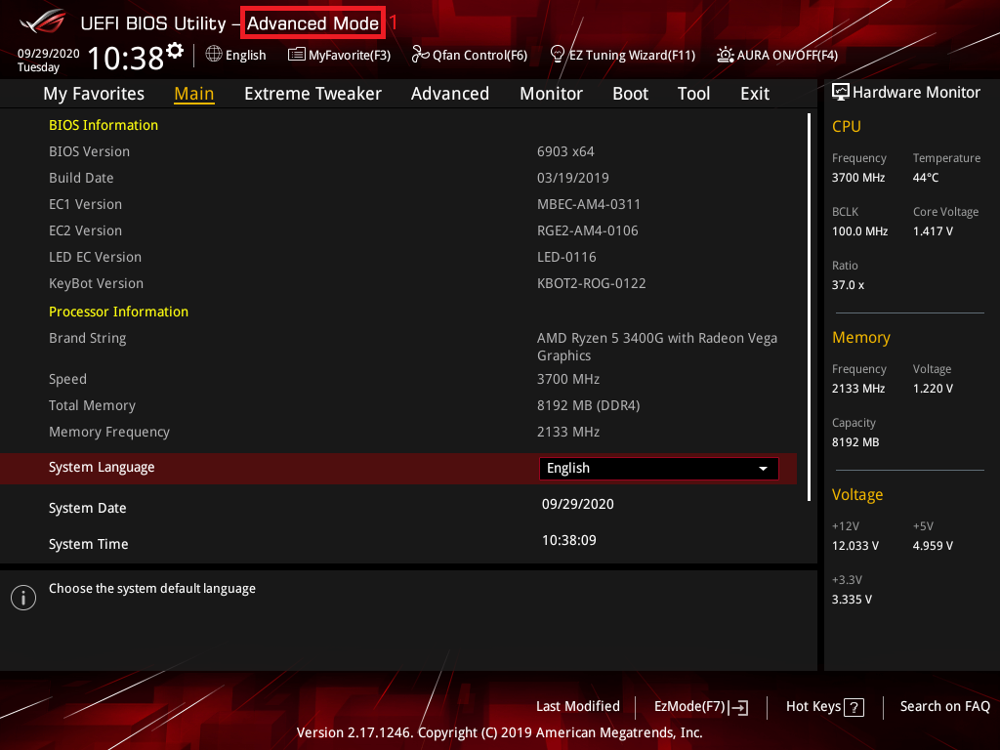
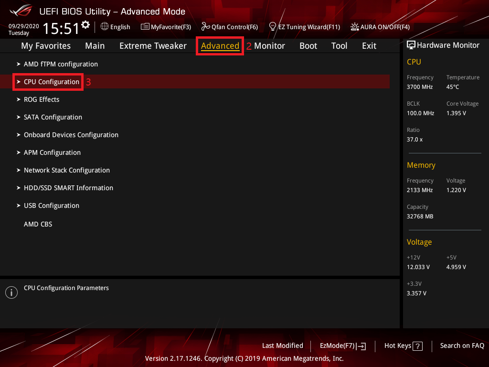
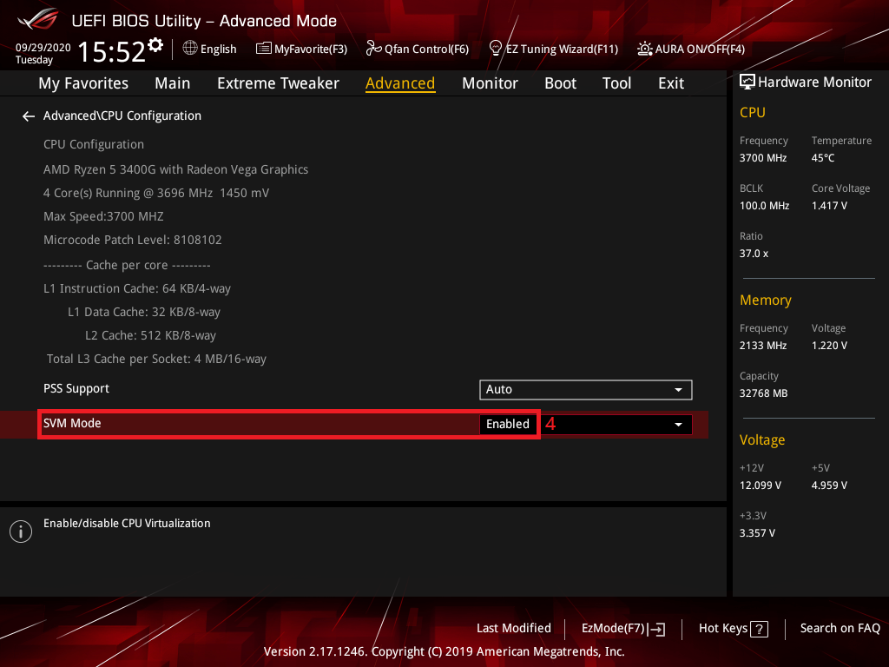
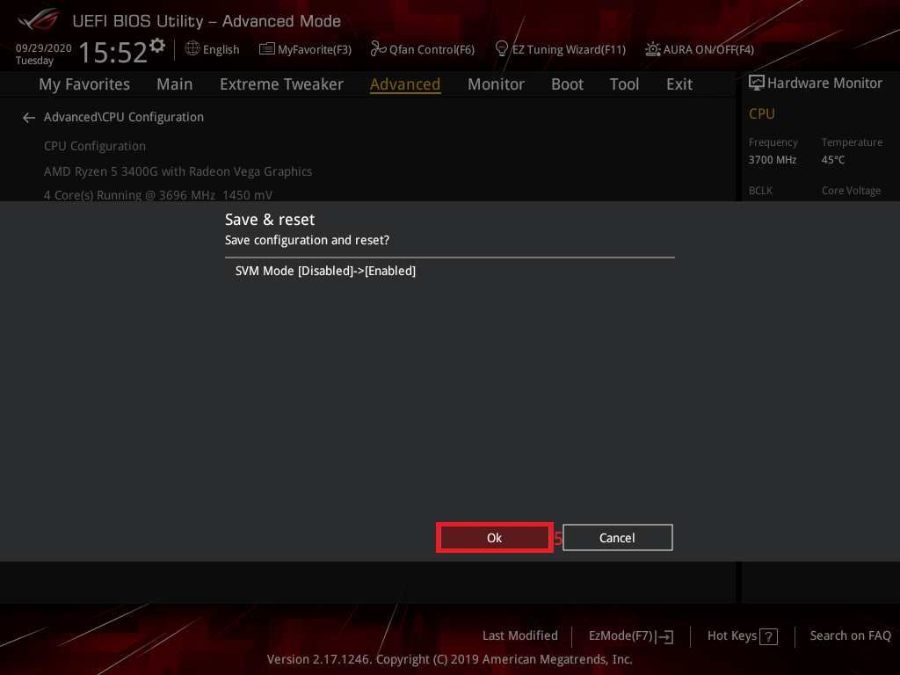

These steps cover ASUS prebuilt PCs and ASUS motherboards. The setup key is **Del**. Not sure which CPU you have? See
[Identifying your CPU](/guides/your-pc/identifying-your-cpu). General guidance is in
[How to enable virtualization support](/guides/your-pc/how-to-enable-virtualization-support-on-your-machine).

## Intel processors

1. Restart your PC and press **Del** repeatedly as it boots to open BIOS setup.
2. If the BIOS opens in **EZ Mode** (#1), press **F7** for **Advanced Mode** (#2).

   ([source](https://www.asus.com/us/support/faq/1045141/#c))
   ([source](https://www.asus.com/us/support/faq/1045141/#c))

3. Open the **Advanced** tab (#3), then **CPU Configuration** (#4).

   ([source)](https://www.asus.com/us/support/faq/1045141/#c)

4. Set **Intel (VMX) Virtualization Technology** (#5) to **Enabled**.

   ([source)](https://www.asus.com/us/support/faq/1045141/#c)

5. Press **F10** and click **OK** (#6) to save and exit.

   ([source)](https://www.asus.com/us/support/faq/1045141/#c)

## AMD processors

1. Restart your PC and press **Del** repeatedly as it boots to open BIOS setup.
2. If the BIOS opens in **EZ Mode**, press **F7** for **Advanced Mode**.

   ([source](https://www.asus.com/us/support/faq/1045141/#c))

3. Open the **Advanced** tab, then **CPU Configuration**.

   ([source](https://www.asus.com/us/support/faq/1045141/#c))

4. Set **SVM Mode** to **Enabled**.

   ([source](https://www.asus.com/us/support/faq/1045141/#c))

5. Press **F10** and click **OK** to save and exit.

   ([source)](https://www.asus.com/us/support/faq/1045141/#c)
