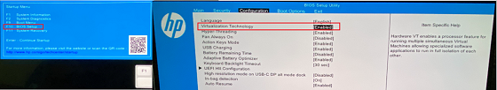
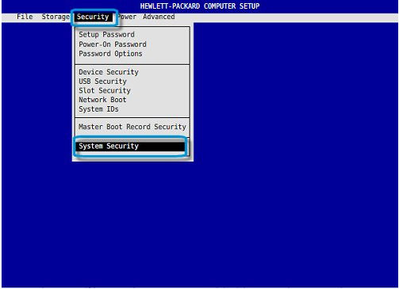
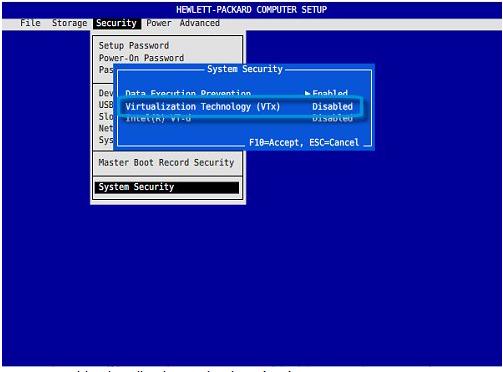
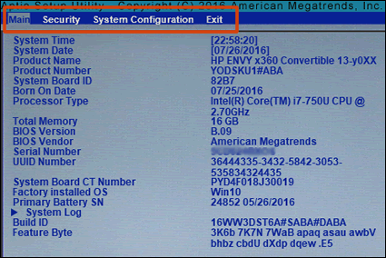

These steps cover HP prebuilt PCs. The setup key is **F10** on all of them, but the menu it lives in differs by product
line. Not sure which CPU you have? See [Identifying your CPU](/guides/your-pc/identifying-your-cpu). General guidance is
in [How to enable virtualization support](/guides/your-pc/how-to-enable-virtualization-support-on-your-machine).

## OMEN, Victus, Spectre, ENVY and Pavilion

1. Restart your PC and press **F10** repeatedly as it boots to open the BIOS Setup Utility.

   

2. Open the **Configuration** tab.
3. Select **Virtualization Technology** and set it to **Enabled** with the left or right arrow key.
4. Press **F10** again to save and exit.

## HP workstations and business PCs

1. Restart your PC and press **F10** repeatedly as it boots to open BIOS setup.

   

2. Open the **Security** tab, then **System Security**.

   

   [(Source)](https://support.hp.com/us-en/document/ish_5637142-5637191-16)

3. Select **Virtualization Technology (VTx)** and set it to **Enabled**.
4. Press **F10** again to save and exit.

## HP and Compaq notebooks

Applies to notebooks made from mid-2011 onwards; older models do not support virtualization.

1. Restart your PC and press **Esc** repeatedly as it boots to open the Startup Menu.
2. Press **F10** to open the BIOS Setup Utility.

   

   ([Source](https://support.hp.com/ca-en/document/c00034791))

3. Open the **System Configuration** tab.
4. Select **Virtualization Technology** and set it to **Enabled**.
5. Press **F10** again to save and exit.
