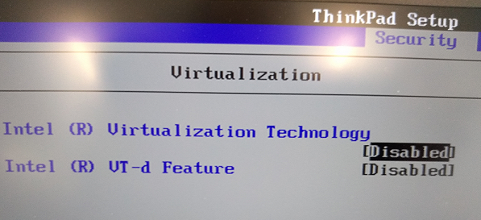
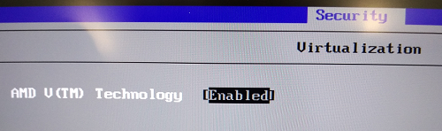
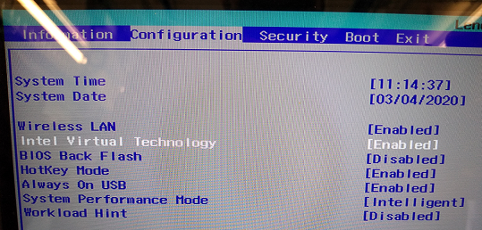
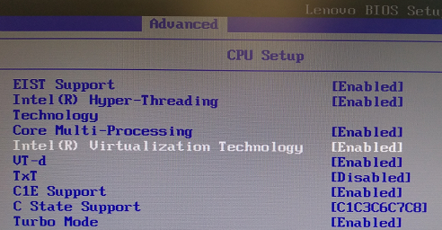

These steps cover Lenovo prebuilt PCs. General guidance is in
[How to enable virtualization support](/guides/your-pc/how-to-enable-virtualization-support-on-your-machine).

## BIOS setup key

Depending on the model, the setup key is **F1** or **F2**. Some laptops need **Fn** held down while you press it, and
you may need to press it repeatedly while the PC boots. Many Lenovo laptops also have a small **Novo** button or pinhole
next to the power connector that boots straight into the BIOS menu.

## ThinkPad (Intel)

1. Restart your PC and press the setup key to open the BIOS Setup Utility.
2. Open the **Security** tab, then **Virtualization**.

   

3. Set **Intel (R) Virtualization Technology** to **Enabled**.
4. Press **F10** to save and exit.

## ThinkPad (AMD)

1. Restart your PC and press the setup key to open the BIOS Setup Utility.
2. Open the **Security** tab, then **Virtualization**.

   

3. Set **AMD V(TM) Technology** to **Enabled**.
4. Press **F10** to save and exit.

## IdeaPad (Intel)

1. Restart your PC and press the setup key to open the BIOS Setup Utility.

   

2. Open the **Configuration** tab.
3. Set **Intel Virtual Technology** to **Enabled**.
4. Press **F10** to save and exit.

## ThinkCentre (Intel)

1. Restart your PC and press the setup key to open the BIOS Setup Utility.

   

2. Open the **Advanced** tab, then **CPU Setup**.
3. Set **Intel (R) Virtualization Technology** to **Enabled**.
4. Press **F10** to save and exit.
