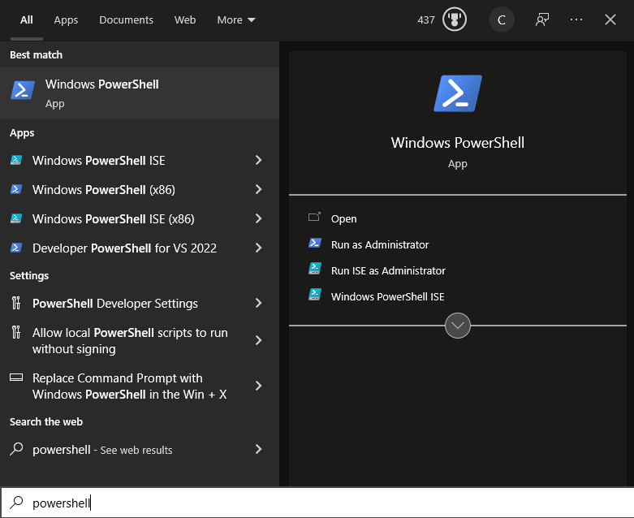
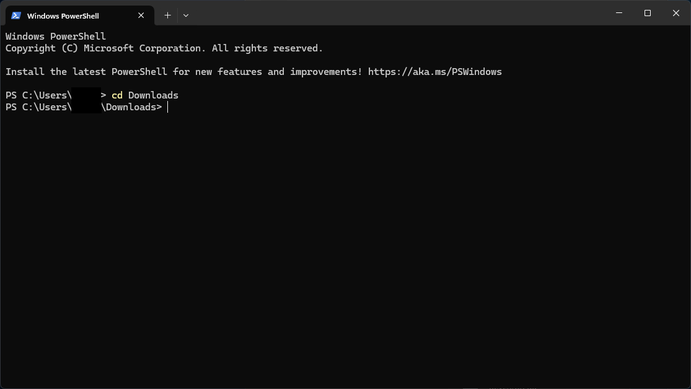
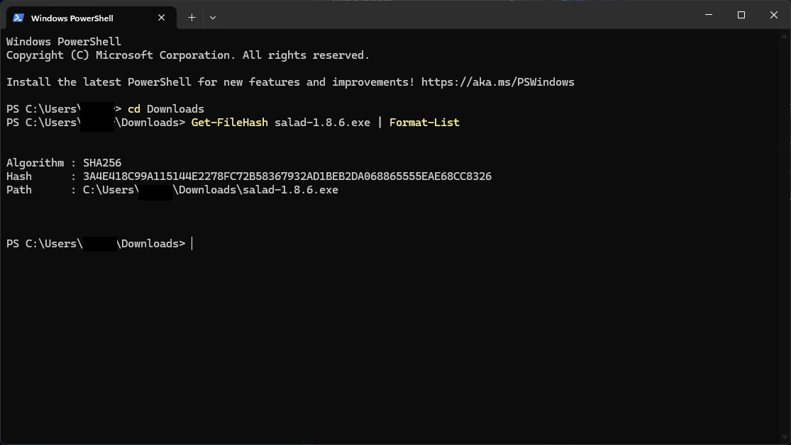

Only download Salad from [salad.com/download](https://salad.com/download) or from the official
[GitHub releases](https://github.com/SaladTechnologies/Salad-Applications/releases). Builds from anywhere else may have
been tampered with to skim your earnings or steal your account.

To confirm a downloaded installer is genuine, compare its hash with the one published on GitHub:

1. Open Windows PowerShell.

   

2. Go to the folder that holds the installer. For Downloads, type `cd Downloads` and press **Enter**.

   

3. Run `Get-FileHash <file name> | Format-List`, replacing `<file name>` with the installer's name, for example
   `Get-FileHash Salad-1.8.6.exe | Format-List`. PowerShell prints the file's SHA256 hash.

   

4. Compare it with the hash listed for the same version on the
   [GitHub releases page](https://github.com/SaladTechnologies/Salad-Applications/releases). If they match, the
   installer is genuine. If they do not, delete the file, run an antivirus scan, and download again from salad.com.

The same check works on the installed `Salad.exe`. If your antivirus flags the genuine installer, see
[Antivirus](/troubleshooting/antivirus).
