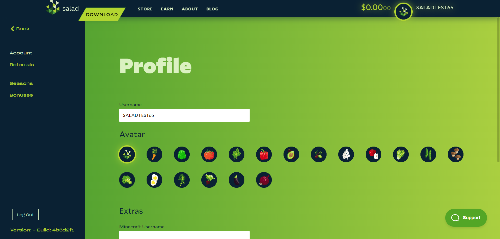
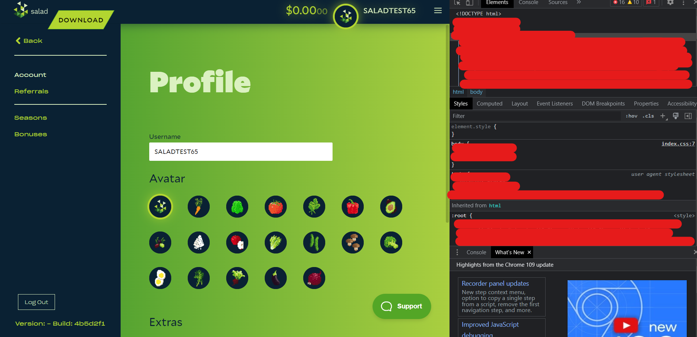
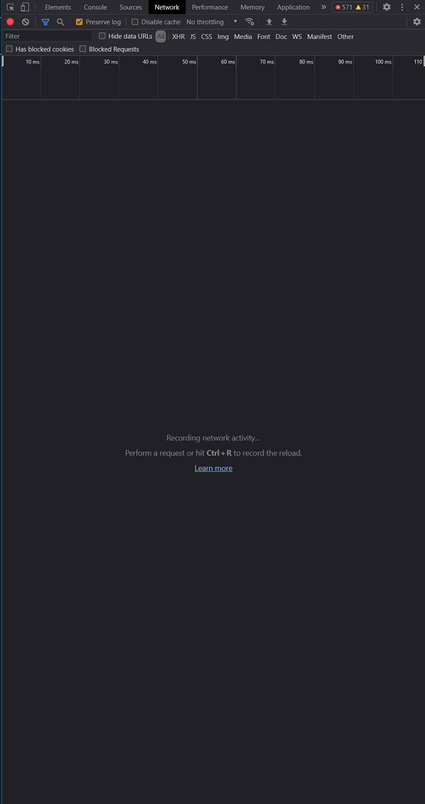
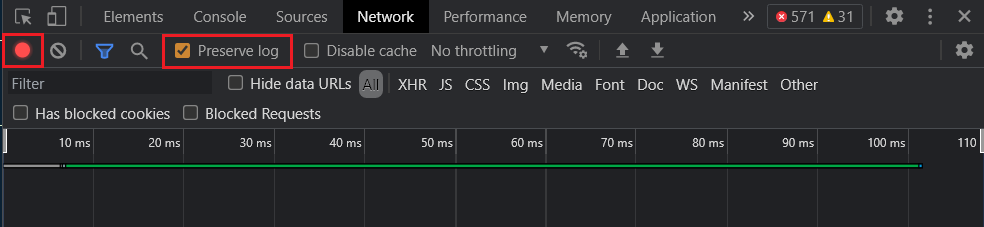
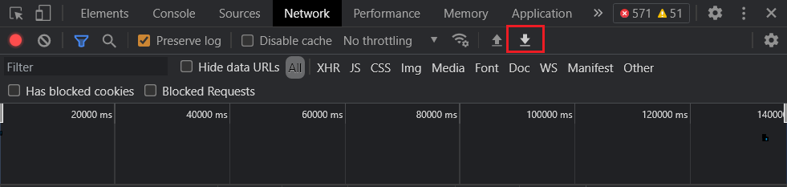

A HAR file is a recording of the network requests between the Salad app (or the Salad website) and Salad's servers.
Support may ask for one when a problem cannot be seen in your logs, for example a page that will not load or an action
that fails silently.

<Callout type="warn">

A HAR file contains session tokens and other personal data. Only send it to Salad Support through your ticket, never
post it publicly.

</Callout>

## From a web browser

Use this for problems on salad.com (store, account pages, redemptions).

1. Open the page where the problem happens in Chrome, Edge or Firefox.
2. Press **F12** (or **Ctrl + Shift + I**) to open the developer tools and select the **Network** tab.
3. Tick **Preserve log** and make sure recording is on (the circle at the top left is red).
4. Click the **clear** button (the circle with a line through it) to empty the list.
5. Reproduce the problem. Requests fill the list.
6. Click the **export** button (a downward arrow, "Export HAR") and save the file somewhere you will find it.
7. Attach the file to your support ticket.

## From the Salad app

The Salad app is built on a web engine with the same developer tools.

1. Open the Salad app. The web app is also reachable through the app's settings or at
   [salad.com/account/summary](https://salad.com/account/summary).

   

2. Press **F12** to open the developer console.

   

3. Select the **Network** tab.

   

4. Check that the record button is red and tick **Preserve log**.

   

5. Clear the list, then reproduce the problem. If it happens on its own, wait until it does.
6. Click **Export HAR** and save the file.

   

7. Attach the file to your support ticket. See
   [How to create a support ticket](/guides/your-pc/how-to-create-a-support-ticket).
