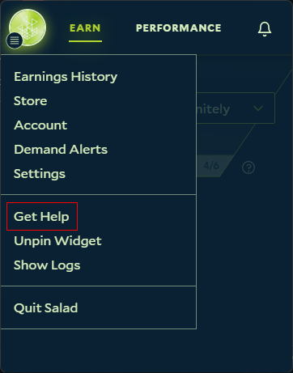
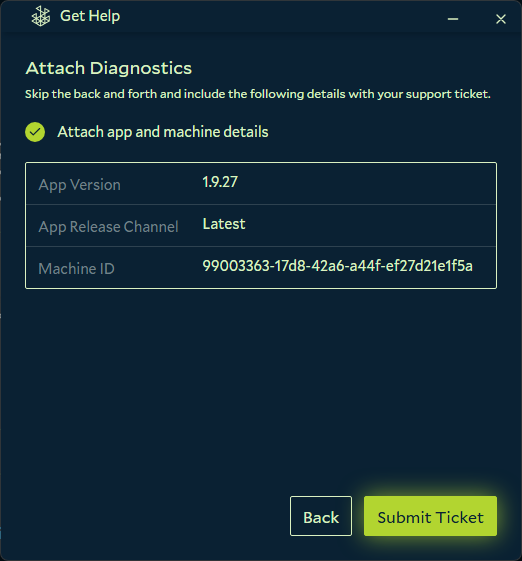
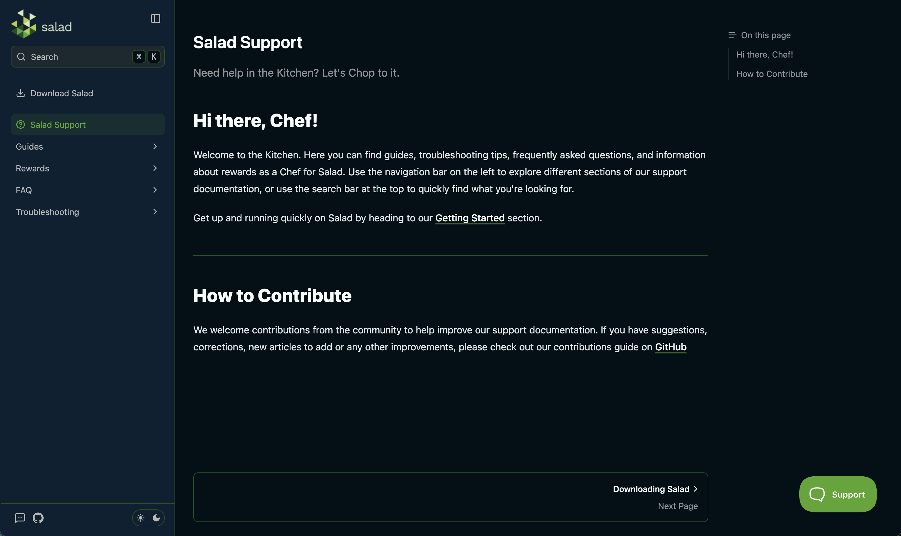
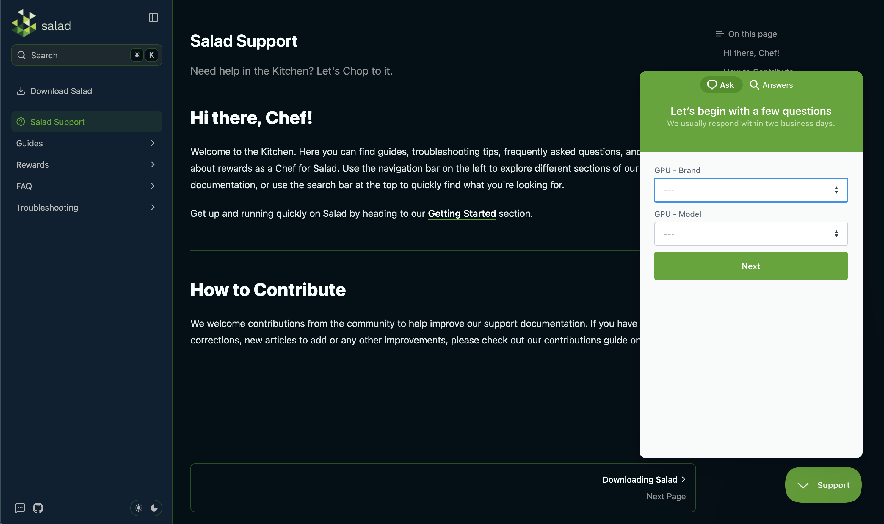

Salad Support can solve most problems in one reply if the first message contains everything needed to look at your
machine. Gather these before you write:

## What to include

1. **Your machine ID**, at least the first 8 characters. Find it in the Salad app:
   [How to find your Salad machine ID](/guides/using-salad/how-to-find-your-salad-machine-id).
2. **A screenshot of the exact notification or error**, not a description of it. The wording and any code in it matter.
3. **Your logs folder, zipped.** See
   [How to find your Salad log files](/guides/using-salad/how-to-find-your-salad-log-files). Attach the zip to the
   ticket; do not paste log text into the message.
4. **What you already tried**, including any guide from this site you followed, so Support does not send you through the
   same steps again.
5. **When it started**, with your time zone, and whether anything changed around then (Windows update, new driver, new
   antivirus, hardware change).

Write from the email address linked to your Salad account. For account questions Support may not be able to help from a
different address.

## Send it from the Salad app

1. Open the Salad app, click your profile picture at the top left and choose **Get Help**.

   

2. Describe the problem, click **Next**, and accept the option to include your machine details. They are attached
   automatically, so you can skip the machine ID.

   

3. Support replies by email, so watch the inbox of your Salad account address.

## Send it from the website

1. Open any page on [salad.com](https://salad.com) and click the **Support** button at the bottom right.

   

2. Choose **Send a message**, fill in the form and attach your screenshot and log zip.

   

3. Your open and past conversations are listed in the same widget under **Previous conversations**, where you can also
   reply.

If the widget does not load, email [support@salad.com](mailto:support@salad.com) with the same information and
attachments. Other ways to reach us (Discord, Reddit) are on the [contact page](/contact).

If Support asks for a HAR file, see [How to create a HAR file](/guides/your-pc/how-to-create-a-har-file).
