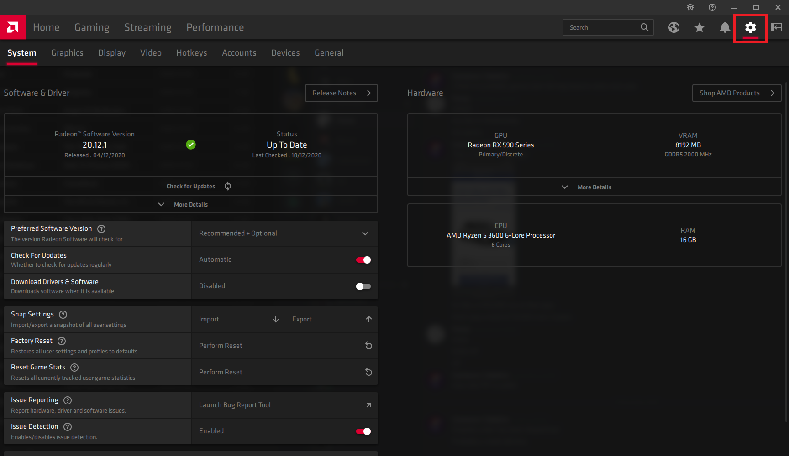
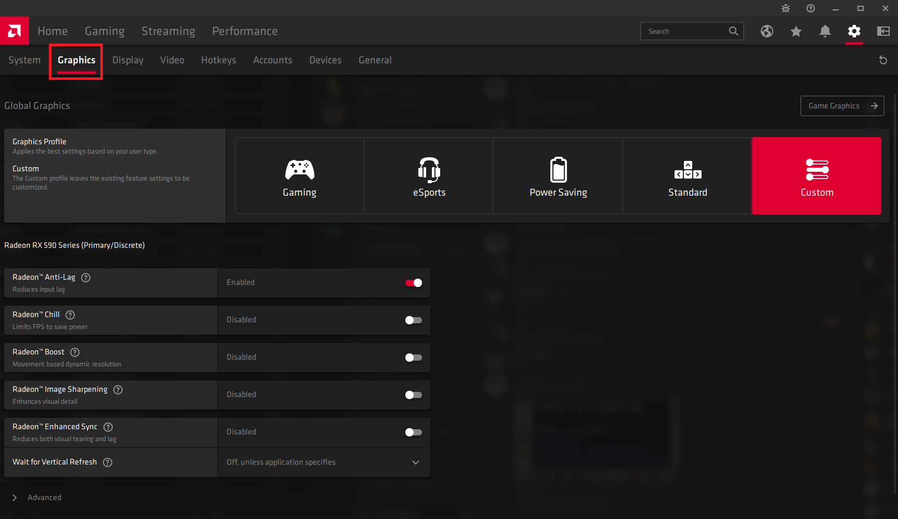
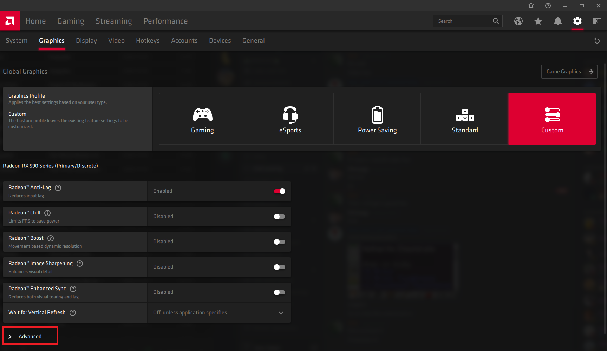
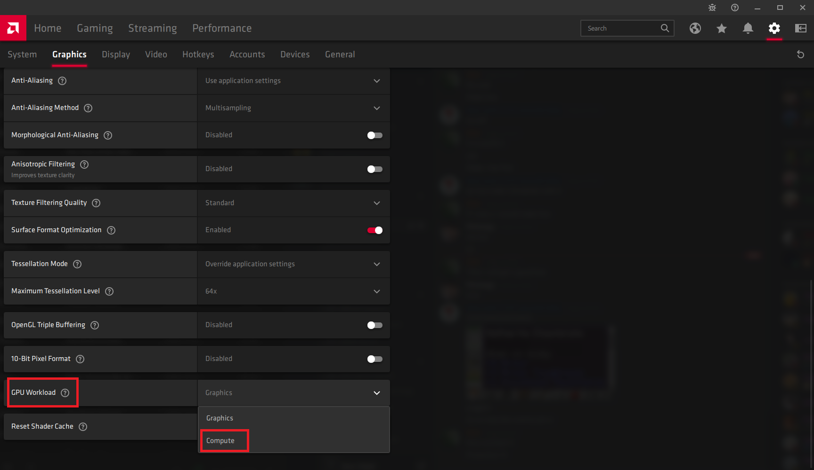
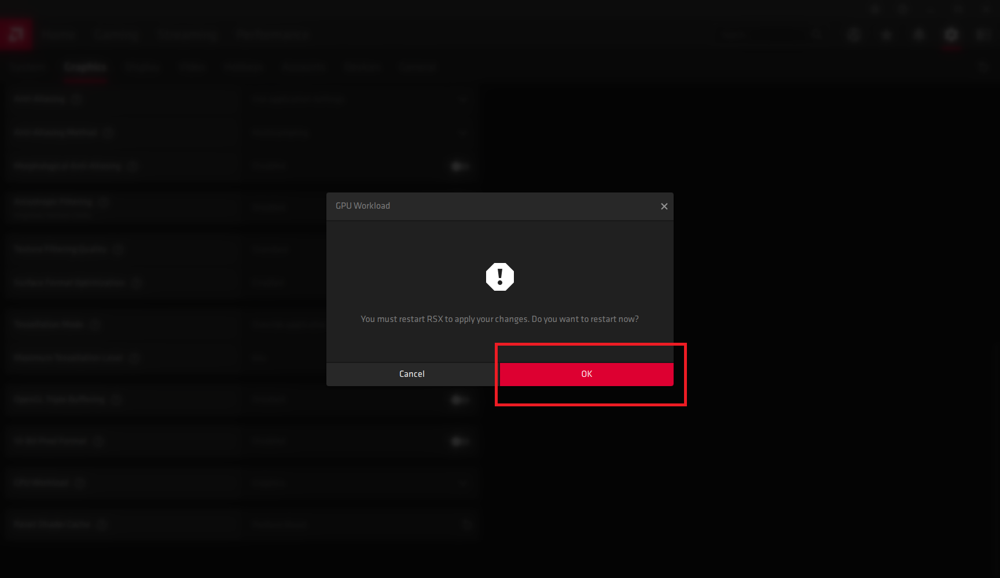

AMD RX 400 and 500 series cards (RX 470, 480, 570, 580 and 590) earn far less on Salad unless the driver's GPU workload
is set to **Compute**. Switch it back to **Graphics** when you want to game, as Compute mode can cost a few FPS in some
titles.

Before you start, [update your AMD drivers](/guides/your-pc/how-to-update-my-amd-drivers) and **stop Salad**.

## Option 1: let Salad do it

1. Stop Salad.
2. [Enable elevated permissions](/guides/using-salad/elevated-permissions) in the Salad app.
3. Start Salad again.

## Option 2: set it in AMD Software

1. Stop Salad.
2. Open AMD Software and click the **gear icon** at the top right.

   

3. Click **Graphics** at the top left.

   

4. Scroll down and click **Advanced**.

   

5. Find **GPU Workload** and set it to **Compute**.

   

6. Click **OK** to restart the graphics driver.

   

Your screen goes black for a moment while the driver restarts. Start Salad again and it should Chop at full speed.
