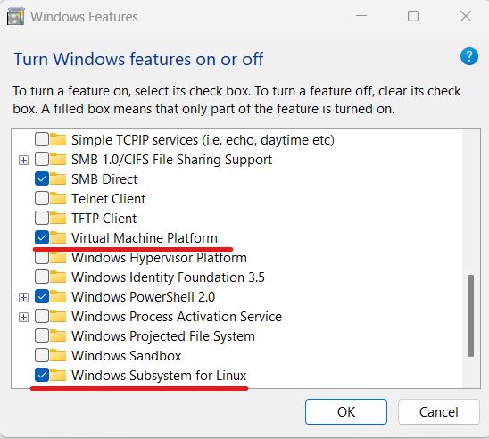

Salad's container environment runs in a virtual machine, so your CPU's virtualization feature must be switched on in the
BIOS. On many PCs it is off by default. Follow this page if Salad's container setup is stuck on virtualization, or a
degraded state asks you to enable virtualization and reboot.

<Callout type="warn" title="Other virtualization software">

Programs that bring their own hypervisor, such as VirtualBox, VMware, Android emulators or some anti-cheat tools, can
conflict with WSL even when virtualization is enabled. See
[Virtualization conflicts with Android emulators](/troubleshooting/container-jobs/virtualization-conflicts-android-emulators).

</Callout>

## General steps

Every BIOS looks a little different; the brand guides below have exact menus and screenshots.

1. Check that your CPU supports virtualization:
   [Does my PC support virtualization?](/faq/compatibility/does-my-pc-support-virtualization). You need Windows 10
   or 11.
2. Restart your PC and press the BIOS setup key as soon as it starts booting. Common keys are **Del**, **F2** and
   **F10**; the brand guides list the key for your PC.
3. Find a tab called **Advanced**, **Chipset**, **Configuration** or **Security**, then a menu called **CPU
   Configuration**, **Advanced CPU Configuration** or **Virtualization**.
4. Enable the virtualization setting. It is named after your CPU maker:
   - **Intel:** Intel Virtualization Technology, Intel (R) VT, VT-x, VTx, VMX or VT-d.
   - **AMD:** SVM Mode, AMD-V, AMD Virtualization or IOMMU.
   - Generic names: Virtualization, Virtual, Secure Virtual Machine, SVM.
5. Save and exit (usually **F10**). The PC reboots.
6. Back in Windows, search for **Turn Windows features on or off** and check that **Virtual Machine Platform** and
   **Windows Subsystem for Linux** are ticked.

Not sure which CPU or board you have? See [Identifying your CPU](/guides/your-pc/identifying-your-cpu) and
[Identifying your motherboard](/guides/your-pc/identifying-your-motherboard).

## Guides by brand

<Cards>
  <Card
    title="ASUS"
    href="/guides/your-pc/enable-virtualization-on-asus-pcs"
    description="ASUS PCs and motherboards, Intel and AMD."
  />
  <Card
    title="Acer"
    href="/guides/your-pc/enable-virtualization-on-acer-pcs"
    description="Acer desktops and laptops."
  />
  <Card
    title="Dell"
    href="/guides/your-pc/enable-virtualization-on-dell-pcs"
    description="Dell desktops and laptops."
  />
  <Card
    title="HP"
    href="/guides/your-pc/enable-virtualization-on-hp-pcs"
    description="OMEN, Victus, Pavilion, workstations and notebooks."
  />
  <Card
    title="Lenovo"
    href="/guides/your-pc/enable-virtualization-on-lenovo-pcs"
    description="ThinkPad, IdeaPad and ThinkCentre."
  />
  <Card
    title="MSI (American Megatrends)"
    href="/guides/your-pc/enable-virtualization-by-motherboard-msi-american-megatrends"
    description="MSI motherboards with the Aptio BIOS."
  />
  <Card
    title="Gigabyte"
    href="/guides/your-pc/enable-virtualization-by-motherboard-gigabyte"
    description="Gigabyte motherboards, Intel and AMD."
  />
</Cards>

If your brand is not listed, search your manufacturer's support site for "enable virtualization" plus your model. If
virtualization is enabled but Salad still cannot set up the container environment, see
[What is WSL?](/guides/your-pc/what-is-wsl). Still stuck? Contact [Salad Support](/contact).
