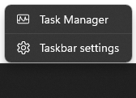
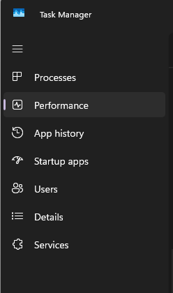
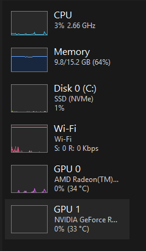
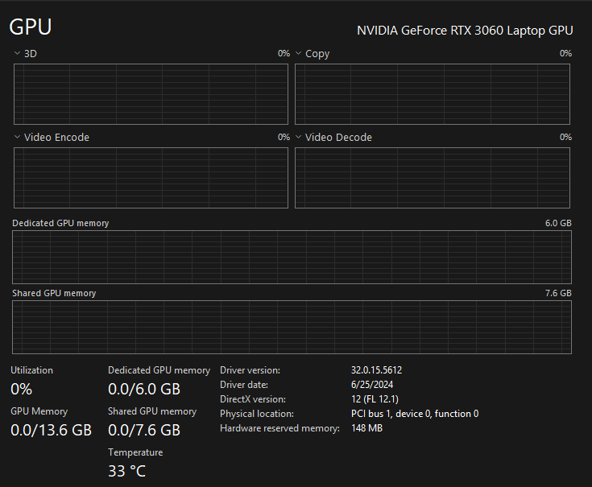
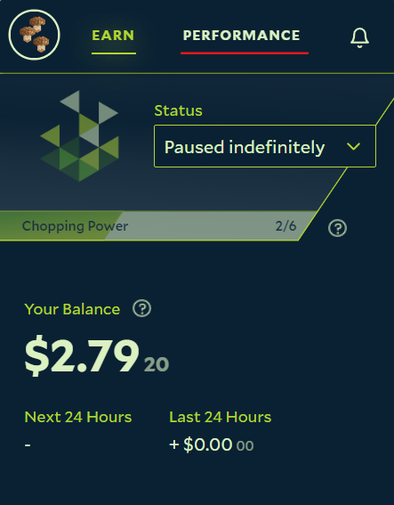
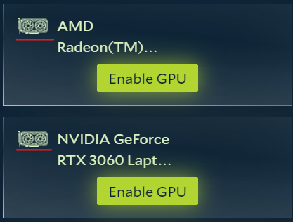
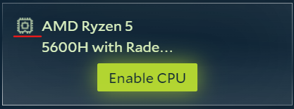

You can find your GPU or CPU model and its details (VRAM, driver version, usage) in Windows Task Manager, or see what
Salad itself has detected in the Salad app. Both methods are below.

## Task Manager

1. Right-click the Windows taskbar and choose **Task Manager**, or search for "task manager" in the Start menu.

   

2. Open the **Performance** tab.

   

3. Click the GPU or CPU you want to inspect.

   

4. The model name is in the top-right corner. For a GPU you also see dedicated VRAM, driver version, temperature and
   current usage.

   

## The Salad app

1. Open the Salad app.

   

2. Open the **Performance** tab.

   

3. GPUs are marked with this icon.

   

4. CPUs are marked with this icon.

   

The Salad app only lists hardware it has detected, so this view is also the quickest way to confirm
[what GPU or CPU Salad is detecting](/guides/your-pc/what-gpu-or-cpu-is-salad-detecting). If your hardware is missing
there but shows in Task Manager, [update Salad](/guides/using-salad/how-to-update-salad) and check that your
[GPU drivers](/guides/your-pc/how-to-reinstall-gpu-drivers) are installed correctly.

Related: [Identifying your CPU](/guides/your-pc/identifying-your-cpu) and
[Identifying your motherboard](/guides/your-pc/identifying-your-motherboard).
