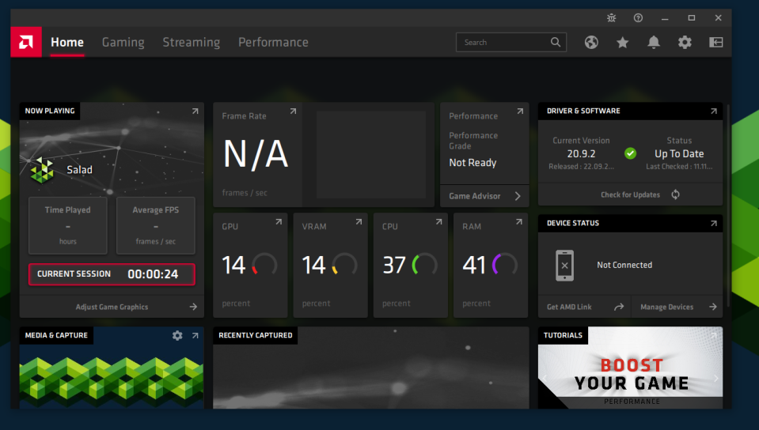
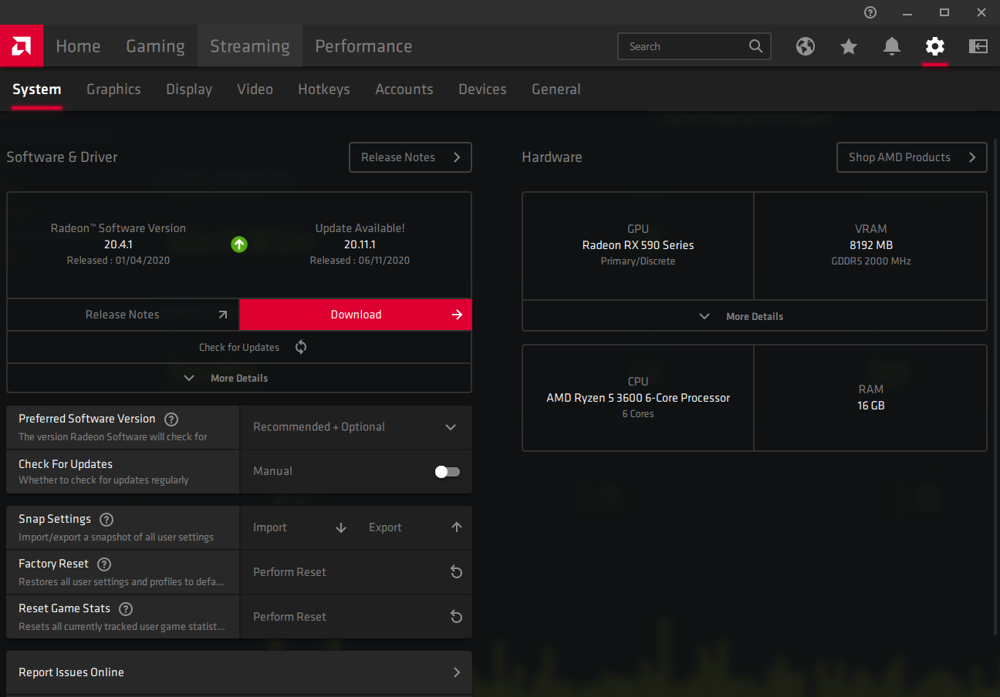

Out-of-date AMD drivers can stop Salad from using your GPU or cut its performance. The quickest update is from AMD
Software itself.

1. Right-click your desktop and open **AMD Software: Adrenalin Edition**, or search for "AMD" in the Start menu.

   

2. Click the **gear icon** at the top right to open settings. If a newer driver is available, a red **Download** button
   appears with the new version listed above it.

   

3. Click **Download** and wait for the driver to download and install.
4. Restart your PC when prompted, then start Salad.

If AMD Software does not open or shows no driver, download the installer directly from the
[AMD drivers page](https://www.amd.com/en/support/download/drivers.html) and choose a **Factory Reset** install, or do a
full [GPU driver reinstall](/guides/your-pc/how-to-reinstall-gpu-drivers).

Chefs with an RX 400 or 500 series card should also
[enable Compute mode](/guides/your-pc/how-to-enable-compute-mode-on-amd-drivers).
