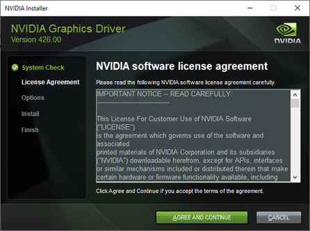
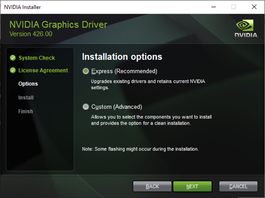

Out-of-date or broken NVIDIA drivers are one of the most common reasons Salad reports a problem with a GPU. Install the
latest driver from NVIDIA, and use the clean-installation option so leftovers from the old driver cannot cause trouble.

1. Go to the [NVIDIA driver download page](https://www.nvidia.com/en-us/drivers/).
2. Enter [your GPU model](/guides/your-pc/how-to-find-your-gpu-or-cpu) in the search box and pick it from the list.
3. Click **Download** under the **Game Ready** driver.
4. Open the downloaded `.exe`. After it unpacks, you see the license screen; click **Agree and continue**.

   

5. Choose **Custom (Advanced)**, click **Next**, then tick **Perform a clean installation** before you continue. This
   removes the old driver's settings and files instead of layering the new driver on top of them.

   

6. When the installation finishes, restart your PC, then start Salad.

<Callout type="info" title="Still having GPU trouble after updating?">

If Salad still shows a degraded state (for example codes -1, 11 or 19) or GPU performance is reported as low while
nothing else is running, do a full [GPU driver reinstall](/guides/your-pc/how-to-reinstall-gpu-drivers) with DDU. See
[Degraded state](/troubleshooting/degraded-state) for what each code means.

</Callout>
