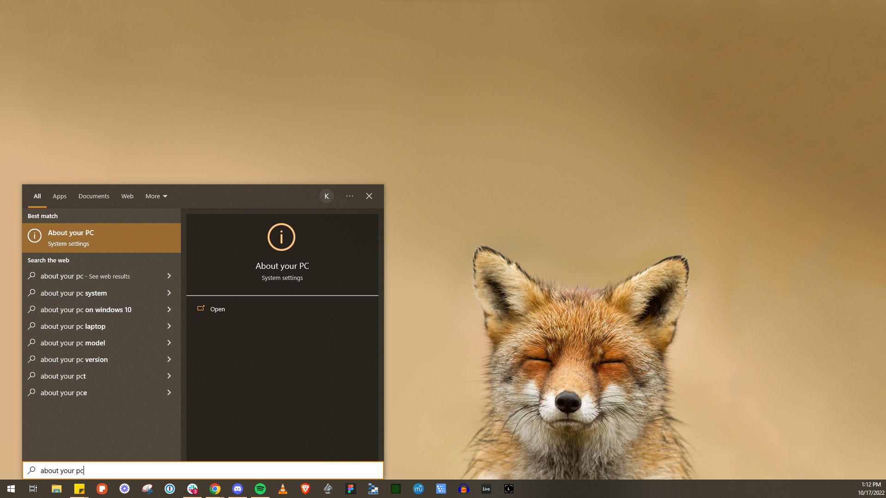
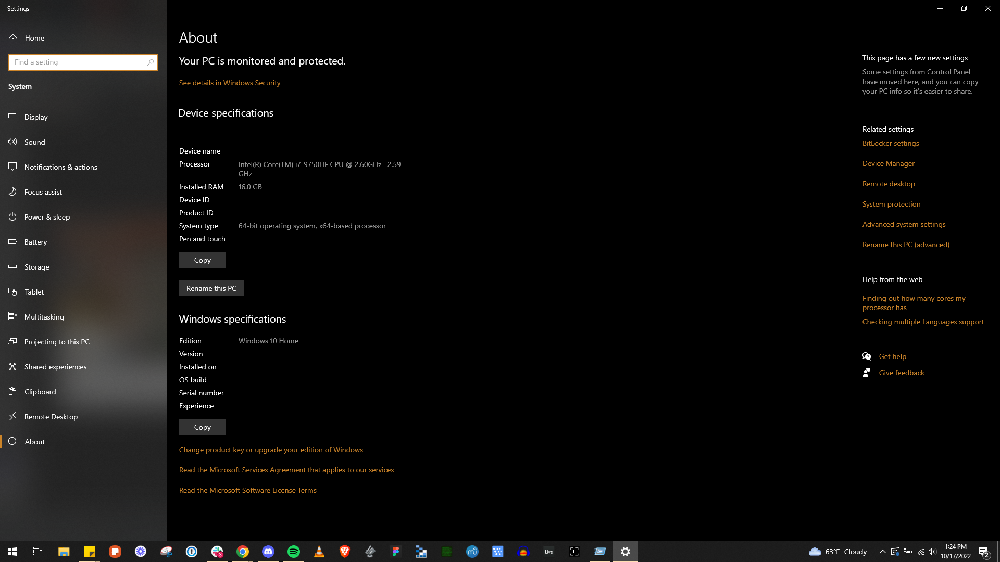

Windows shows your processor model in the "About" page of Settings.

1. Press the **Windows** key to open the Start menu.
2. Type "About your PC" and open the **About your PC** settings page.

   

3. Your processor is listed under **Device specifications**.

   

Knowing whether you have an Intel or AMD CPU tells you which BIOS setting to look for when
[enabling virtualization](/guides/your-pc/how-to-enable-virtualization-support-on-your-machine).

Related: [How to find your GPU or CPU specifications](/guides/your-pc/how-to-find-your-gpu-or-cpu) and
[Identifying your motherboard](/guides/your-pc/identifying-your-motherboard).
