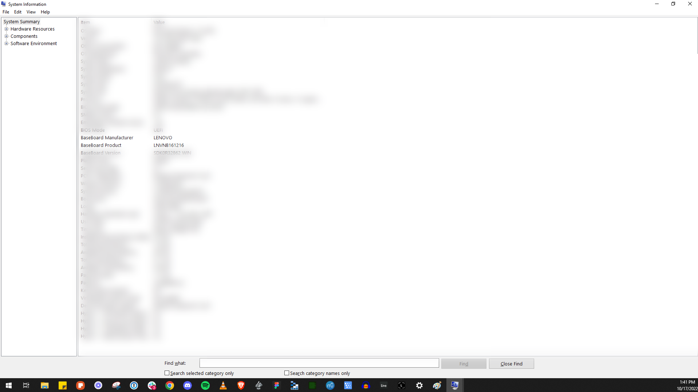

You do not need to know your motherboard to run Salad, but the model helps you find the right BIOS guide when
[enabling virtualization](/guides/your-pc/how-to-enable-virtualization-support-on-your-machine) or searching your
manufacturer's documentation.

1. Press **Windows + R** to open the Run dialog.
2. Type `msinfo32` and press **Enter**.

   

3. Read the **BaseBoard Manufacturer** and **BaseBoard Product** rows: that is your motherboard brand and model.

   

On a prebuilt or laptop PC, the **System Manufacturer** and **System Model** rows (the PC brand, for example Dell or HP)
are usually more useful than the motherboard model, because the BIOS is customized by the PC maker.

Related: [Identifying your CPU](/guides/your-pc/identifying-your-cpu) and
[How to find your GPU or CPU specifications](/guides/your-pc/how-to-find-your-gpu-or-cpu).
