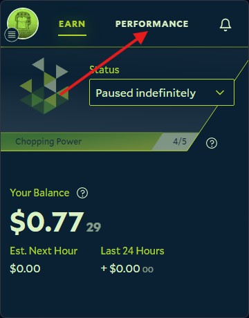
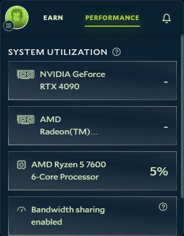

The Performance tab in the Salad app shows every GPU and CPU Salad has detected. Salad can only send jobs to hardware
that appears here.

1. Open the Salad app.

   

2. Click the **Performance** tab on the right-hand side.

   

3. Each detected GPU or CPU has its own block.

   

## My hardware is missing or wrong

- Compare the list with what Windows reports: see
  [How to find your GPU or CPU specifications](/guides/your-pc/how-to-find-your-gpu-or-cpu).
- A GPU that Windows shows but Salad does not usually points to a driver problem. Do a clean
  [driver reinstall](/guides/your-pc/how-to-reinstall-gpu-drivers).
- If the GPU is detected but Salad reports a problem with it, start at
  [Degraded state](/troubleshooting/degraded-state).
- Salad does not support multiple GPUs in one PC; only the primary GPU is used.

If the hardware is still not detected, send [Salad Support](/contact) your machine ID and a screenshot of the
Performance tab, following [How to create a support ticket](/guides/your-pc/how-to-create-a-support-ticket).
