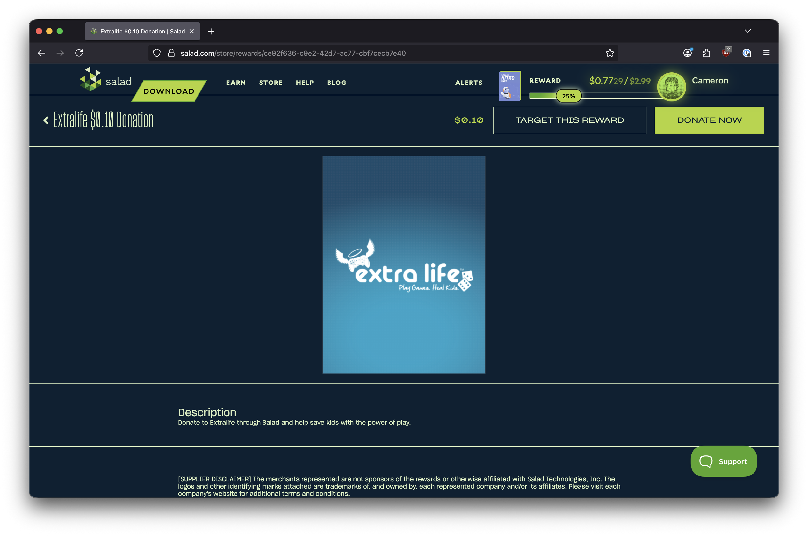
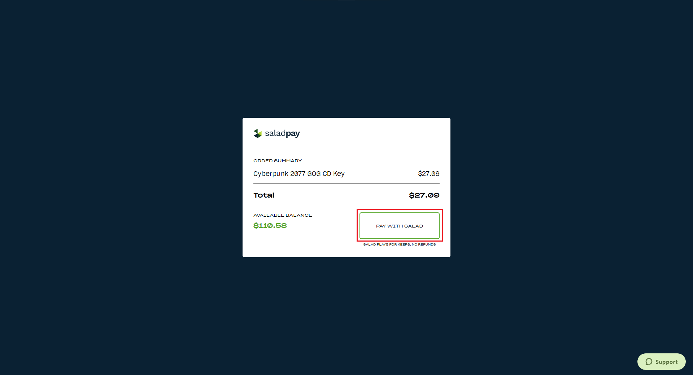

Rewards are redeemed on the [Storefront](https://salad.com/store) with your Salad Balance. You need enough balance to
cover the reward's price; once you click **Buy Now** the redemption is final, so check the reward's region and
description first.

<Steps>
<Step>

### Find the reward

Open the [Storefront](https://salad.com/store) and scroll or use the search bar to find the reward you want, then click
it.

</Step>
<Step>

### Check the reward page

The reward page shows the full name, description and price. Before you continue, make sure:

- the name and description match what you want (the right game, platform or card type), and
- the reward is for [your region and currency](/rewards/help/what-region-is-this-reward-for).

When you are sure, click **Buy Now** at the top right.

</Step>
<Step>

### Pay with Salad Balance

The checkout screen shows what you are about to redeem. Salad plays for keeps: there are
[no refunds or exchanges](/rewards/help/i-want-a-refund) once a reward is redeemed, so confirm the details, then click
**Pay with Salad**.

</Step>
<Step>

### Collect your reward

A notification confirms the redemption. Codes for games, subscriptions and gift cards appear in your
[Reward Vault](/rewards/help/reward-vault-and-redemption-codes) and in a redemption email. Cash-like rewards (PayPal,
Venmo, prepaid Visa and Mastercard) are delivered by email with a claim link instead.

</Step>
</Steps>

## Targeted rewards

Setting a reward as your target only adds a progress bar that tracks your balance against its price. Your Salad Balance
is not locked to it, so you can change the target at any time without losing anything, and you can redeem a different
reward whenever you have enough balance.

## Need help?

If the reward has not arrived, see
[I redeemed a reward but haven't received it](/rewards/help/i-redeemed-a-reward-but-havent-received-it). For anything
else, contact [Salad Support](/contact).
