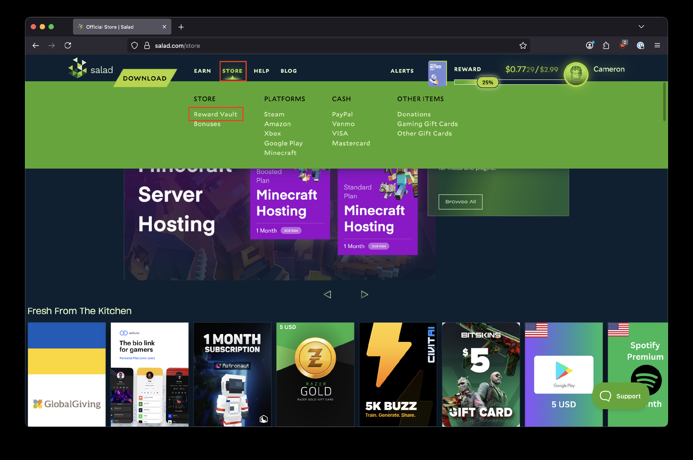
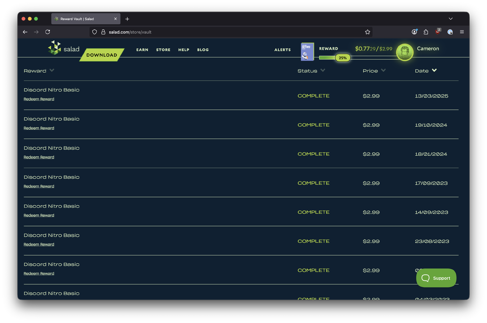

The [Reward Vault](https://salad.com/store/vault) keeps your redemption history and, for most rewards that need an
activation code (games, Discord Nitro, gift cards, subscriptions), the code itself. The same code is also sent in a
redemption email to the email address on your Salad account.

## Opening the Reward Vault

Hover over the Store navigation on [salad.com](https://salad.com/store) and select **Reward Vault**, or go straight to
[salad.com/store/vault](https://salad.com/store/vault).

Each redemption is listed with its date and status.

If the reward comes with a code, copy it with the clipboard icon and enter it where the reward is activated (Steam,
Amazon, the game's store, and so on). The reward's description tells you where the code is valid.

## Rewards delivered by email

Cash-like rewards are not shown as a code in the Vault. PayPal, Venmo, prepaid Visa and Mastercard, and some gift cards
are delivered by our reward partner Tremendous: shortly after you redeem, an email with a claim link arrives at your
Salad account's email address, and you claim the reward there. See
[How to redeem PayPal](/rewards/redeeming-your-rewards/how-to-redeem-paypal) for an example.

## Reward not there yet?

Most rewards arrive within minutes, but some are issued by third-party providers and can take up to 24 hours. If nothing
has shown up in the Vault or your inbox after that, follow
[I redeemed a reward but haven't received it](/rewards/help/i-redeemed-a-reward-but-havent-received-it).
