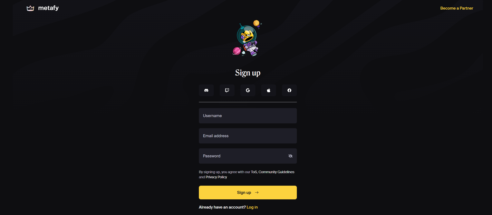
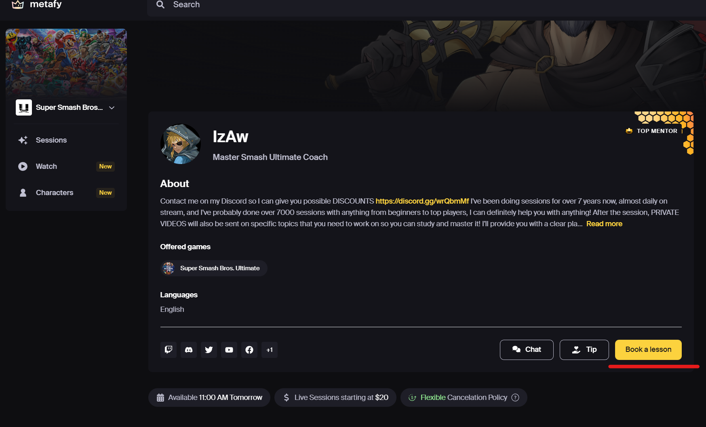
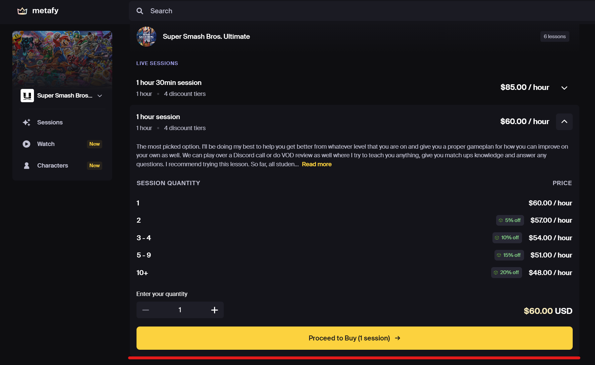
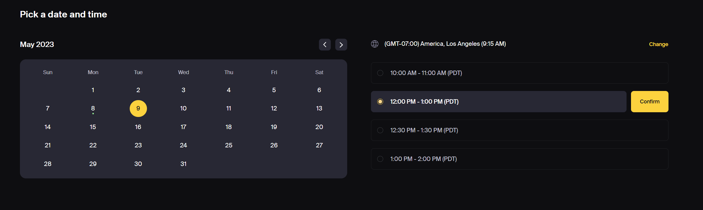
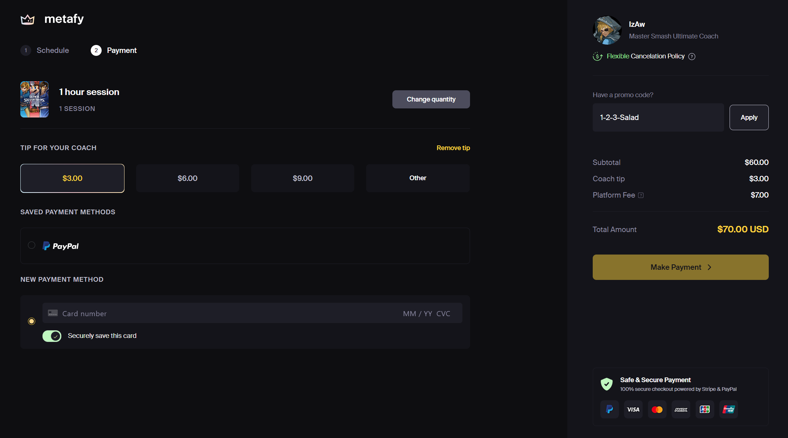
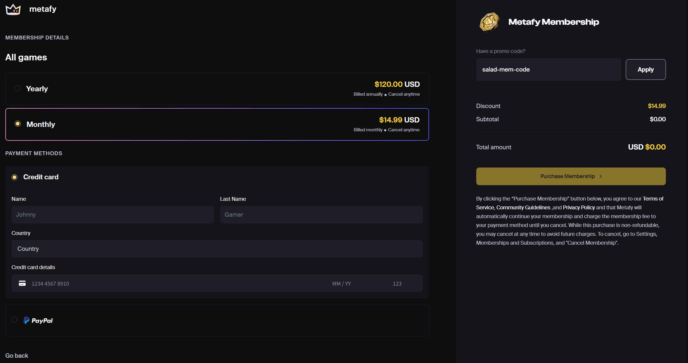

Once you have purchased a Metafy gift card from the Salad Storefront, you'll receive a gift card code that can be
redeemed for Metafy's coaching content. Metafy gift cards can be cashed in when the user books a coach.

_Please note: In order to use your Metafy gift card, you will need to create a free account at_
[https://metafy.gg/](https://metafy.gg/) . _To create an account and use your Metafy gift card, follow the directions
below._

1. Create a Metafy account.

   

2. Sign up with your email, Discord, Twitch, Gmail, Apple ID or Facebook account.

   

3. Select your coach and Book a Session.

   

4. Select a session length and proceed to check out.

   

5. Chose a time and connect with your coach via Discord.

   

   

6. Enter your Salad gift card code in the **_Have a promo code?_** section.

   

7. Check out and wait for your coach to contact you.

A user's gift card balance will never expire and cannot be transferred to another account. Check our Metafy's
[Terms and Conditions](https://metafy.notion.site/Metafy-Terms-of-Service-16472ffe2d0443b1bce4ce4ff43b7a1f).

---

### Metafy Memberships

Metafy memberships redeemed with Salad Balance are applied directly to your Metafy account. After redeeming, you receive
an email with a redemption code and link.

1. Open the Metafy membership URL from the email or your
   [Reward Vault](/rewards/help/reward-vault-and-redemption-codes). It takes you to this page:

   

2. Click on 'Become a Member'

3. Enter your Salad membership code in the **_Have a Promo Code?_** box and hit apply. Memberships renew monthly, so you
   will need to enter your Paypal or credit card information in order to complete the process.

   

_Metafy renews monthly and you can cancel at any time. If you do not want to pay for an additional month, cancel the
membership from your Metafy account page._

## Experiencing issues?

If Metafy rejects the code or the membership does not apply, contact Metafy support from their site. See
[Problems using a reward](/rewards/help/problems-using-a-reward) for what to send them and what to send Salad.
