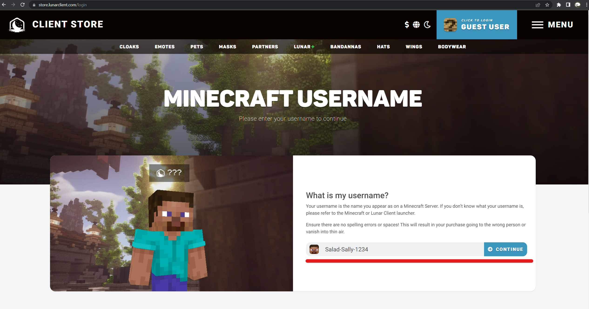
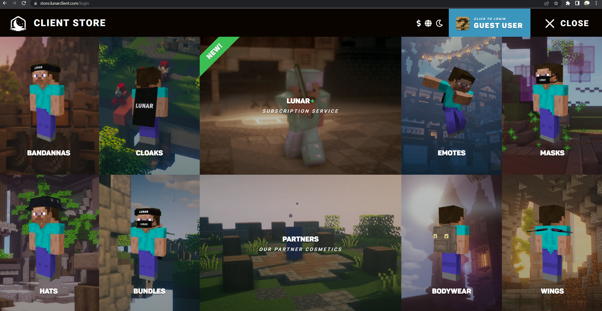
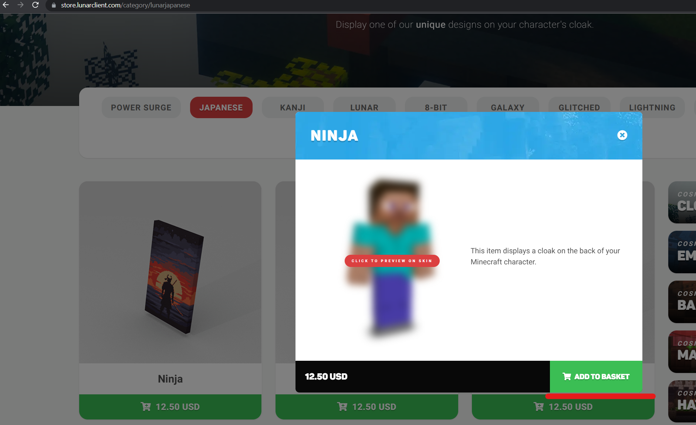

Lunar Client rewards are redeemed as a coupon in the Lunar Client store. Find your code in your
[Reward Vault](/rewards/help/reward-vault-and-redemption-codes), then follow these steps.

1. Go to [Lunar Client](https://store.lunarclient.com/) store.

   

2. Sign in using your Minecraft username. You will need to sign in to redeem your Lunar reward.

   

3. Find the item type you purchased with your Salad balance.

   

4. Click the item you want to redeem and then click "Add to Basket".

   

5. Enter the code from Salad on the right side of the screen where it says "Redeem Coupon".

6. Click "Checkout" and follow the instructions to apply the item to your Minecraft account.

## Experiencing issues?

If the coupon is rejected or the item does not appear in-game, contact Lunar Client support from their store. See
[Problems using a reward](/rewards/help/problems-using-a-reward) for what to send them and what to send Salad.
