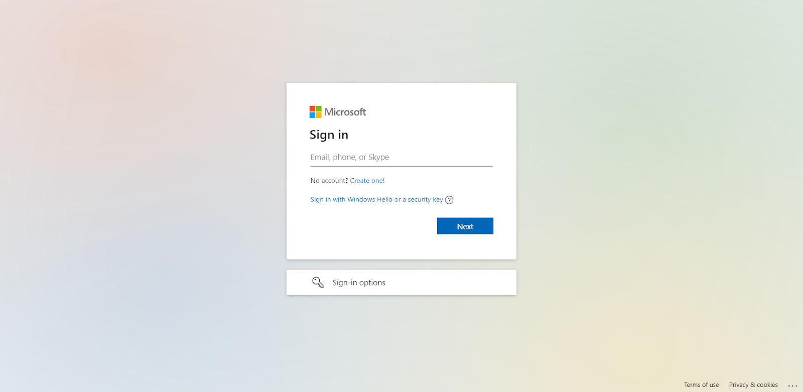
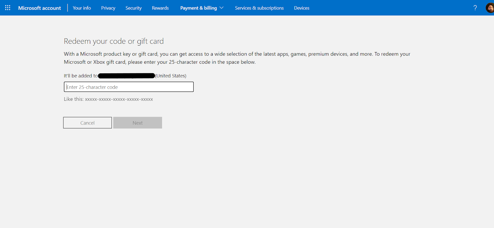

Digital Xbox gift cards feature unique, 25-character redemption codes. Once you have purchased an Xbox reward from the
Salad Storefront, you should find this code listed in your
[Reward Vault](/rewards/help/reward-vault-and-redemption-codes) within a few minutes. This code will also appear in the
redemption email sent to the email address on your Salad account.

When you have found your redemption code, you may use it to apply your gift card balance to a Microsoft account in any
of the ways detailed below.

---

## Method 1: Redeeming online

_Redeeming online is the simplest way to apply gift card balance to a Microsoft account._

1. Visit [https://redeem.microsoft.com](https://redeem.microsoft.com).

   

2. When prompted, log in to an existing Microsoft account (or create a new one).

   

3. Enter your 25-character redemption code on the next screen.
4. Click "Next" and follow the remaining prompts

---

## Method 2: Xbox One and Series X|S

1. Press the **Xbox button** on your controller to open the Guide.
2. Select "Store" from the available choices.
3. When the Store app has loaded, press the **View button** to expand the side menu.
4. Select "Redeem" from the available choices.
5. Enter the 25-character redemption code.
6. Select "Next" and follow the remaining prompts.

---

## Method 3: Microsoft Store app on Windows

1. Press the "Start" button and type "store" to begin a search.
2. Select the "Microsoft Store" application from the available choices.
3. Expand the "Account" menu located in the top-right of the screen.
4. Select "Redeem code or gift cards" from the menu.
5. Enter the 25-character redemption code.
6. Select "Next" and follow the remaining prompts.

---

## Method 4: Xbox app on Windows

_This method cannot currently be used within the Xbox mobile application._

1. Press the "Start" button and type "xbox" to begin a search.
2. Select the "Xbox" application from the available choices.
3. Click your profile avatar located in the top-left of the screen.
4. Select "Settings" from the menu.
5. Scroll to the "Redeem a Code" section and select "Redeem."
6. Enter the 25-character redemption code.
7. Select "Next" and follow the remaining prompts.

---

## Method 5: Xbox 360 console

1. Press the Xbox button on your controller to open the Guide.
2. Select "Games & Apps" from the available choices.
3. Select "Redeem Code" on the next menu.
4. Enter the 25-character redemption code.
5. Submit the code and follow the remaining prompts.

---

## Experiencing issues?

If the code is rejected, check it is being entered on the Microsoft account and in the region stated on the reward, then
contact [Xbox Support](https://support.xbox.com). See [Problems using a reward](/rewards/help/problems-using-a-reward)
for what to send them and what to send Salad.
