## How do I redeem Cybrancee rewards?

Once you have redeemed a Cybrancee voucher on the Storefront, you receive an activation code that is applied as a
promotion code on Cybrancee's site. Find it in your [Reward Vault](/rewards/help/reward-vault-and-redemption-codes) or
in the redemption email, then follow the section below for the product you redeemed.

To manage your Cybrancee plan you need a free account at [cybrancee.com](https://cybrancee.com/). New accounts go
through a manual review, so your service activates once the Cybrancee team has approved your request.

All products start from Cybrancee's
[redemption page for Salad Chefs](https://cybrancee.com/client/index.php?rp=%2Fstore%2Fsponsorship-hosting).

---

## Discord bot hosting

1. Open the [redemption page](https://cybrancee.com/client/index.php?rp=%2Fstore%2Fsponsorship-hosting).

   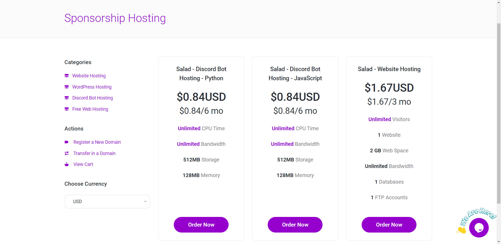

2. Select the "Discord Bot Hosting" plan that matches the scripting language of your Salad reward (JavaScript or
   Python).

3. Enter your redemption code in the text field under "Promotion" and click "Validate Code."

   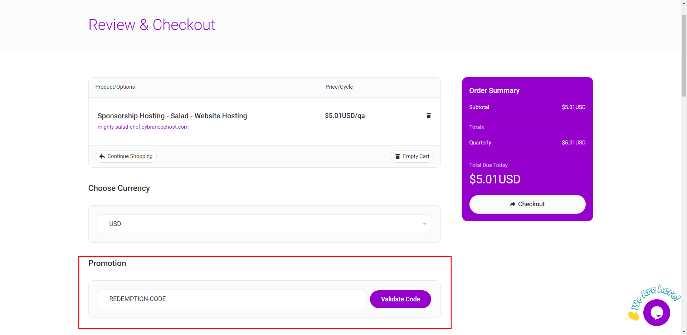

4. On the next screen, check that your balance due is now zero.

   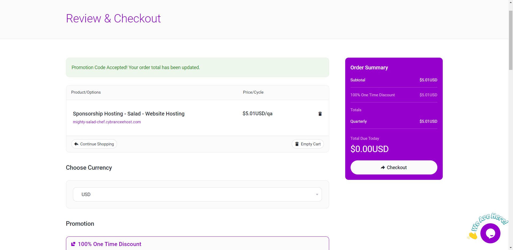

5. Complete the account registration form.

   

6. Under "Payment Method," select "No Payment Method."

   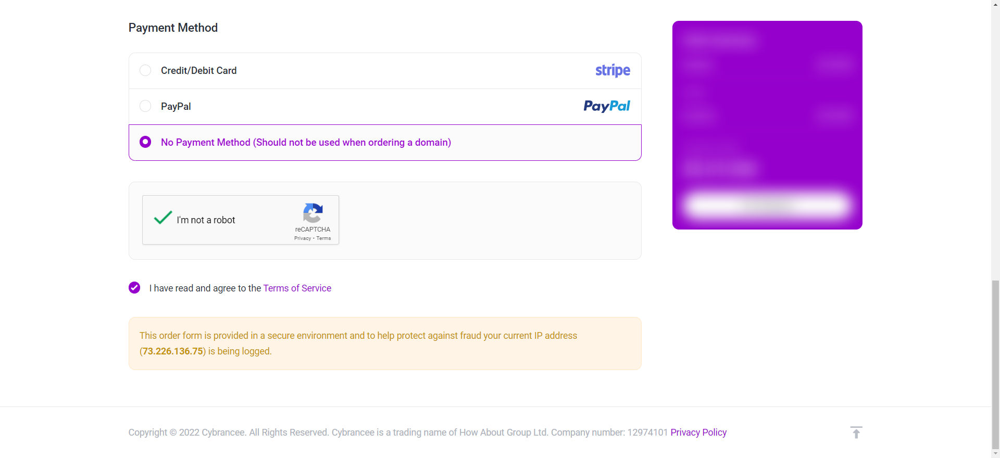

7. Read and agree to Cybrancee's Terms of Service.

8. Click "Checkout" in the pane on the right to complete your order.

   

---

## Web hosting

1. Open the [redemption page](https://cybrancee.com/client/index.php?rp=%2Fstore%2Fsponsorship-hosting).

   

2. Select "Salad – Website Hosting" and click "Order Now."

3. Choose whether to register a new domain, transfer an existing one, or create a free subdomain on Cybrancee, and enter
   the URL in the text field.

   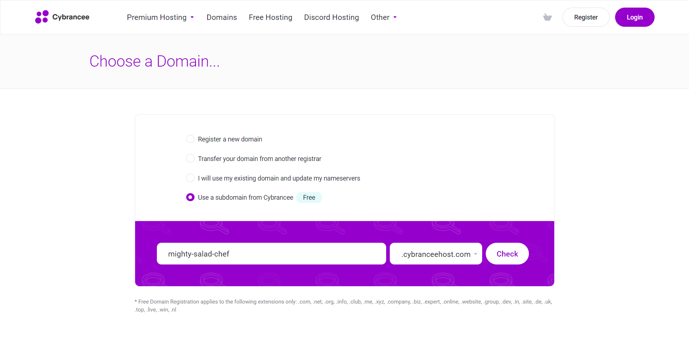

   Registering a new domain costs extra: you will need a valid credit card or PayPal account at checkout. Your Salad
   voucher only covers the hosting.

4. Click the submit button ("Check," "Transfer," or "Use," depending on the option you chose).

5. Enter your redemption code in the text field under "Promotion" and click "Validate Code."

   

6. On the next screen, check that your balance due is now zero.

   

7. Complete the account registration form.

   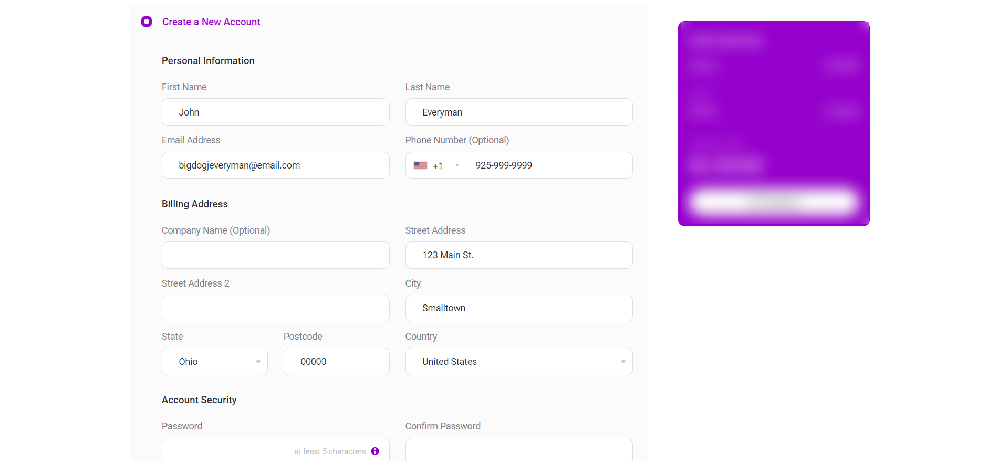

8. Under "Payment Method," select "No Payment Method." Do not select this when registering a new premium domain, or the
   order will be rejected.

   

9. Read and agree to Cybrancee's Terms of Service.

10. Click "Checkout" in the pane on the right to complete your order.

    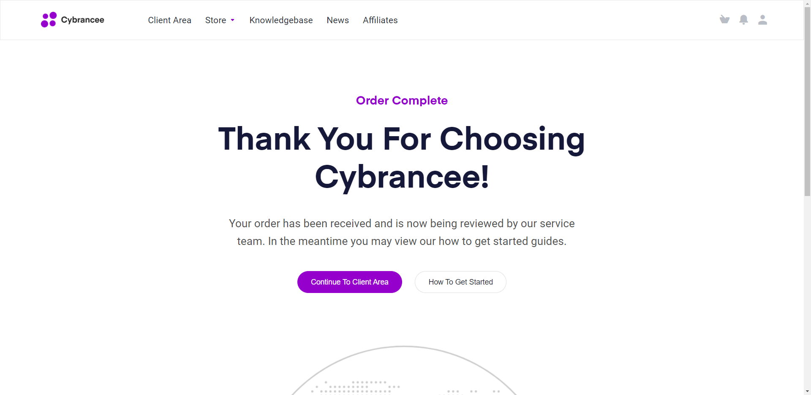

---

## Domain

The domain reward covers a one-year registration.

1. Open the [redemption page](https://cybrancee.com/client/index.php?rp=%2Fstore%2Fsponsorship-hosting).

   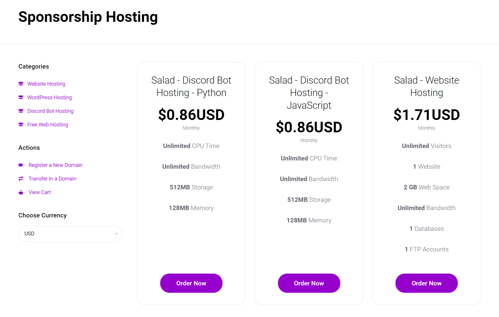

2. Search for your domain at [cybrancee.com/domains.php](https://cybrancee.com/domains.php) or
   [cybrancee.com/client/cart.php?a=add&domain=register](https://cybrancee.com/client/cart.php?a=add&domain=register).

3. Enter the domain name you want and add it to the cart.

   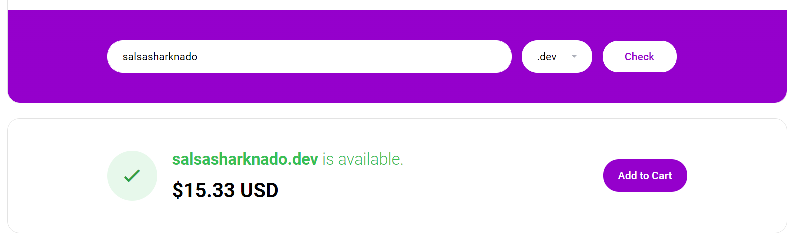

4. Click "Continue" once the domain is in the cart.

5. Approve the domain's SSL agreement.

   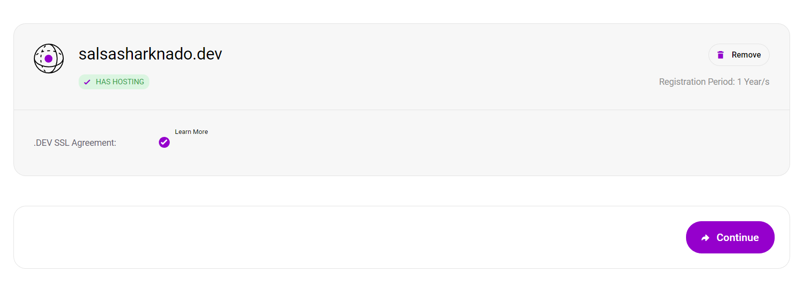

6. On the checkout page, enter your Salad promotion code and agree to the Terms of Service. Web hosting is offered as a
   paid extra; remove it to use your code for the domain only.

   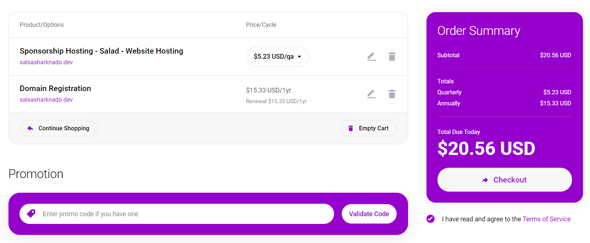

7. Further down you are asked for payment information. To skip entering a payment method, select the PayPal option.

---

## Minecraft hosting

1. Open the [redemption page](https://cybrancee.com/client/index.php?rp=%2Fstore%2Fsponsorship-hosting%2F).

2. Select the Minecraft loader you intend to use with your server and press "Continue."

   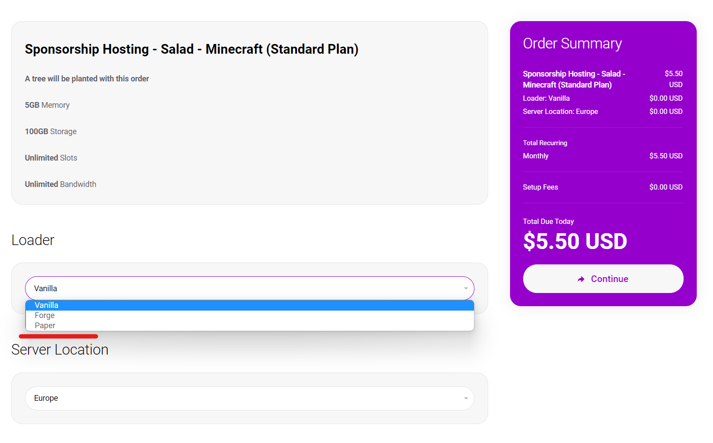

3. On the checkout page, apply the promotion code from Salad.

   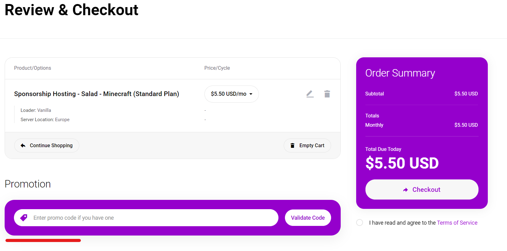

4. Enter your Cybrancee account details, or create an account, and check out.

5. An email arrives shortly with instructions on how to access and manage your new Minecraft server.

---

## Experiencing issues?

If the code is rejected, your account is still under review, or the service does not start, see Cybrancee's
[help center](https://cybrancee.com/learn/) or contact Cybrancee support from your client area. See
[Problems using a reward](/rewards/help/problems-using-a-reward) for what to send them and what to send Salad.
